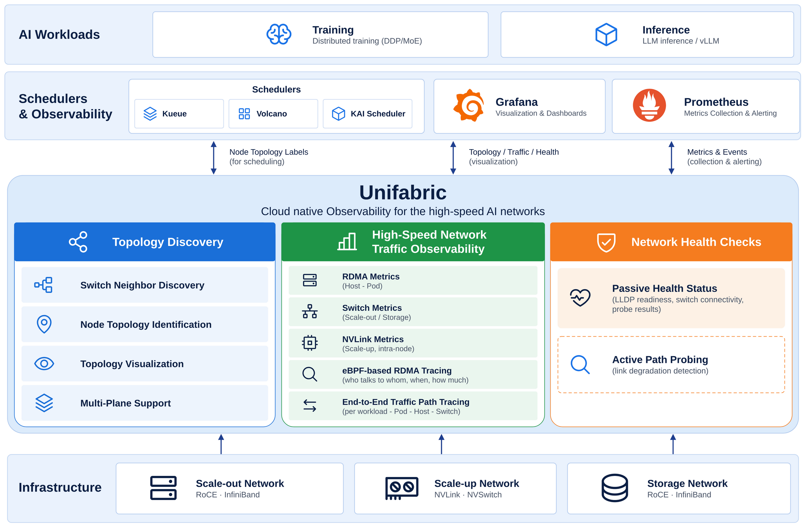

# Unifabric

English | [简体中文](./README-zh_cn.md)

> Cloud native Observability for the high-speed AI networks.

## Introduction

A modern AI cluster depends on three high-speed networks: the scale-out network for
GPU communication across nodes (RoCE or InfiniBand), the scale-up network for GPU
interconnect inside a node (NVLink and similar), and the high-speed storage network.
Training and inference performance depends on these networks. Congestion or
degradation on one link can slow down a whole job, or interrupt a training run.

To the cloud-native stack, these networks are a black box. They are built from
switches, routers, and NICs of many vendors. The observability tools of this
hardware do not connect to each other, and do not connect to the Kubernetes resource
model or its monitoring stack. Current cloud-native observability is built around
TCP/IP and does not cover RDMA or NVLink. A network anomaly cannot be attributed to
a Pod or a training job. This is the "last mile" problem of AI workload
observability.

Unifabric closes this gap in a cloud-native way. It discovers the topology of the
three networks, observes RDMA and NVLink traffic and attributes it to workloads, and
probes network health proactively. Whatever the hardware vendor is, Unifabric
presents the result through one Kubernetes resource model: CRDs, Node labels, and
metrics. The observation also feeds back into scheduling. Schedulers such as Kueue
and Volcano consume the topology labels, which improves training and inference
efficiency.

## Architecture

Unifabric sits on top of the scale-out, scale-up, and storage networks. It discovers
them directly, or imports topology from NVIDIA Topograph and NetQ. It presents the
three core capabilities through one Kubernetes resource model. Schedulers, Grafana,
and Prometheus consume the result.

## Core Features

### Topology discovery

Topology discovery probes and identifies, in real time, the connections between
hosts, switches, and other devices across the scale-out, scale-up, and storage
networks. It turns the physical topology, which is scattered across vendor
devices, into standard Kubernetes resources that other systems consume directly.

Capabilities:

- **Tiered Node labels**: writes each node's position in the network (leaf, spine,
  and other tiers) into Node labels. Schedulers such as Kueue TAS, Volcano, and
  KAI Scheduler consume the labels directly and place communication-heavy jobs
  inside one switch domain, which shortens communication paths and improves
  training and inference efficiency.
- **Topology visualization**: publishes `Topology` resources and renders the whole
  fabric interactively in Grafana. Operators see the global connection state
  without logging into switches and quickly confirm which nodes and links are in
  the affected scope during troubleshooting.

Applicability:

- Supports general SONiC RoCE switches (LLDP-based discovery), NVIDIA Spectrum-X,
  and InfiniBand (imported from NVIDIA Topograph)
- Supports bare-metal and cloud environments

### AI high-speed network traffic observability

AI high-speed network traffic observability collects traffic data for the three high-speed
networks by reading NIC counters, collecting switch metrics, and attaching eBPF
probes, and attributes it to
Pods, namespaces, workloads, and hosts, turning device-level traffic into
business-level observability. The goal is to answer network questions in
workload terms—whether a slow job is caused by the network, and whose traffic
affects whom—and to provide the evidence for performance analysis and
troubleshooting of AI training and inference.

Capabilities:

- **RDMA metrics on host and Pod NICs**: covers throughput, congestion, and error
  metrics, and provides endpoint-side data for performance analysis and
  troubleshooting
- **Pod identity association for switch traffic**: associates RDMA traffic on
  switches in the scale-out and storage networks with specific Pods, which closes
  the gap between device traffic and workload identity
- **eBPF-based RDMA flow observability**: RDMA communication bypasses the kernel
  stack, so packet capture and connection tracking are useless and the NIC
  exposes only aggregate counters—the communication relations are a black box.
  For CPU-initiated RDMA communication, this feature attaches eBPF probes to the
  submit path of the verbs library and reconstructs Pod-level RDMA flows without
  any application change: who talks to whom, when, and how much per send, making
  RDMA communication as observable as TCP connections.
- **NVLink traffic metrics (planned)**: collects GPU-to-GPU NVLink communication metrics on the
  scale-up network, which makes intra-node GPU interconnect—a traditional
  monitoring blind spot—observable

Use cases:

- **When a training or inference job slows down**: locate communication hot
  spots—correlate RDMA metrics along the path (switches, Pod NICs, and more) at
  the AI workload level and find the applications that consume the bandwidth
- **During performance analysis and tuning**: analyze the timing, peers, and
  message sizes of Pod RDMA communication and confirm the communication pattern
  is as expected
- **When troubleshooting network congestion or anomalies**: answer whose traffic
  it is and which workload it affects quickly with prebuilt Grafana dashboards
  and determine the affected scope

### Network health checks

Network health checks continuously monitor the links and configuration of
the three high-speed networks and surface problems proactively, instead of
troubleshooting after a workload reports a failure.

Capabilities:

- **Passive health status collection**: continuously collects LLDP readiness, switch
  connectivity, and probe results, which reflects the health of the network
  infrastructure in real time
- **Active network path probing and link degradation detection (planned)**: probes
  network paths actively and finds link degradation before it triggers alerts

Use cases:

- **During routine inspection of large clusters**: keep track of link and switch
  health continuously without checking devices one by one
- **Before launching a training job**: verify the health of the network paths in
  advance, so long-running training jobs are not interrupted or slowed down by
  link degradation or configuration faults

## Quick Start

Follow the [deployment guide](./docs/getting-started.md) to install Unifabric. It
covers the default SONiC RoCE network and also supports the InfiniBand and
NVIDIA Spectrum-X environments.

After installation, refer to the following guides for each feature:

- Topology discovery and visualization: [topology visualization](./docs/usage/topology-visualization.md)
- Topology-aware scheduling: [Kueue / Volcano / KAI scheduling integration](./docs/usage/workload-tas.md)
- AI high-speed network traffic observability: [AI high-speed network traffic observability](./docs/usage/traffic-observability/README.md)
- Switch traffic observability: [Switch Agent deployment](./docs/usage/switch-agent-deployment.md)

## Roadmap

See the [roadmap](./docs/roadmap.md) for planned features and future direction.

## Community and Contributing

Contributions are welcome:

- Report bugs or propose features through [GitHub issues](https://github.com/unifabric-io/unifabric/issues).
- Set up a development environment with the [NVAIR development guide](./docs/development/dev-with-nvair.md).
- Before you submit a pull request, run `make build`, `make test-unit`, and `make check-license`.
- Sign off your commits with `git commit -s` to certify the [Developer Certificate of Origin](https://developercertificate.org/).

## Origin

DaoCloud created this project on 2026-04-19. See the public repository history at
[unifabric-io/unifabric](https://github.com/unifabric-io/unifabric) for provenance.

## License

Apache License 2.0. See [LICENSE](./LICENSE).
