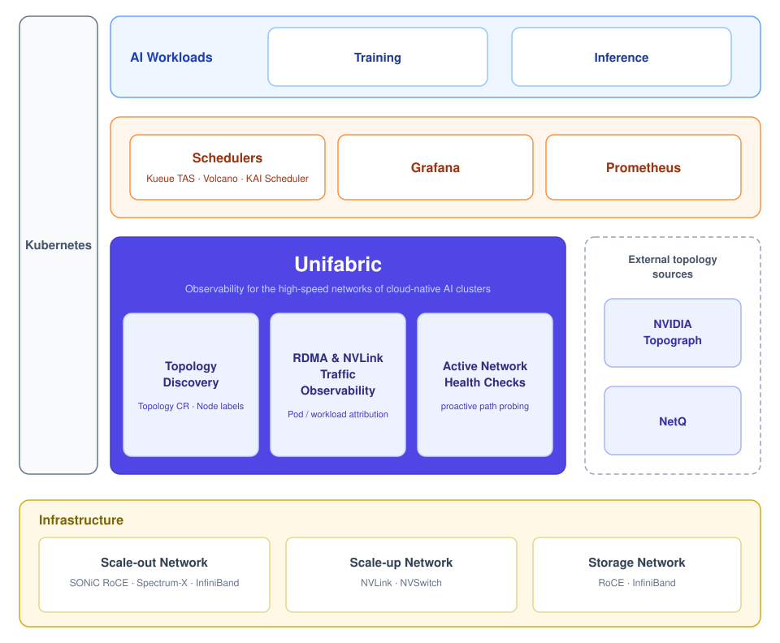

# Unifabric

English | [简体中文](./README-zh_cn.md)

> Observability for the high-speed networks of cloud-native AI clusters.

## Introduction

A modern AI cluster depends on three high-speed networks: the scale-out network for
GPU communication across nodes (RoCE or InfiniBand), the scale-up network for GPU
interconnect inside a node (NVLink and similar), and the high-speed storage network.
Training and inference performance depends on these networks. Congestion or
degradation on one link can slow down a whole job, or interrupt a training run.

To the cloud-native stack, these networks are a black box. They are built from
switches, routers, and NICs of many vendors. The observability tools of this
hardware do not connect to each other, and do not connect to the Kubernetes resource
model or its monitoring stack. Current cloud-native observability is built around
TCP/IP and does not cover RDMA or NVLink. A network anomaly cannot be attributed to
a Pod or a training job. This is the "last mile" problem of AI workload
observability.

Unifabric closes this gap in a cloud-native way. It discovers the topology of the
three networks, observes RDMA and NVLink traffic and attributes it to workloads, and
probes network health proactively. Whatever the hardware vendor is, Unifabric
presents the result through one Kubernetes resource model: CRDs, Node labels, and
metrics. The observation also feeds back into scheduling. Schedulers such as Kueue
and Volcano consume the topology labels, which improves training and inference
efficiency.

## Core Features

### Topology discovery

Unifabric discovers the topologies of the scale-out, scale-up, and storage networks.
It publishes them as `Topology` resources and tiered Node labels, and renders them
in Grafana. Schedulers such as Kueue TAS, Volcano, and KAI Scheduler consume the
labels and place communication-heavy jobs inside one switch domain. Operators locate
fault domains on the rendered topology. Unifabric supports general SONiC RoCE
fabrics (LLDP-based discovery), NVIDIA Spectrum-X, and InfiniBand (imported from
NVIDIA Topograph).

### RDMA and NVLink traffic observability

Unifabric observes RDMA traffic on the scale-out and storage networks, and NVLink
traffic on the scale-up network. It collects data from host NICs, container NICs,
switches, and eBPF flow attribution. Throughput, congestion, and error metrics are
attributed to Pods, namespaces, and workloads, so the metrics answer whose traffic
it is and which workload it affects. Prebuilt Grafana dashboards ship with the
chart.

### Active network health checks

Unifabric probes the paths of the high-speed networks proactively, before a workload
reports a problem. Link degradation and configuration faults surface before they
affect training and inference jobs.

## Architecture

Unifabric sits on top of the scale-out, scale-up, and storage networks. It discovers
them directly, or imports topology from NVIDIA Topograph and NetQ. It presents the
three core capabilities through one Kubernetes resource model. Schedulers, Grafana,
and Prometheus consume the result. For the component architecture, see the
[architecture overview](./docs/concepts/architecture.md).

## Quick Start

1. Complete the [basic installation](./docs/getting-started.md).
2. Follow the guide for your physical network:
   - [General SONiC RoCE](./docs/getting-started-sonic-roce.md)
   - [NVIDIA Spectrum-X](./docs/getting-started-spectrum-x.md)
   - [InfiniBand](./docs/getting-started-infiniband.md)

To understand which discovery mode each network uses, see the
[topology discovery concept](./docs/concepts/topology-discovery.md).

## Documentation

| Category | Link |
| --- | --- |
| Documentation index | [docs/README.md](./docs/README.md) |
| Architecture and concepts | [Architecture overview](./docs/concepts/architecture.md), [Topology discovery](./docs/concepts/topology-discovery.md) |
| Getting started | [Basic installation](./docs/getting-started.md), [General SONiC RoCE](./docs/getting-started-sonic-roce.md), [NVIDIA Spectrum-X](./docs/getting-started-spectrum-x.md), [InfiniBand](./docs/getting-started-infiniband.md) |
| Feature usage | [Topology visualization](./docs/usage/topology-visualization.md), [RDMA metrics](./docs/usage/rdma-metrics.md), [RDMA flow attribution](./docs/usage/rdma-flow.md), [Workload TAS](./docs/usage/workload-tas.md), [Switch Agent deployment](./docs/usage/switch-agent-deployment.md) |
| API reference | [FabricNode, Switch, Topology, and RDMAEndpoint](./docs/reference/README.md) |
| Helm values | [Chart reference](./chart/README.md) |
| Design documents | [docs/design/](./docs/design/) |

## Roadmap

See the [roadmap](./docs/roadmap.md) for planned features and future direction.

## Community and Contributing

Contributions are welcome:

- Report bugs or propose features through [GitHub issues](https://github.com/unifabric-io/unifabric/issues).
- Set up a development environment with the [NVAIR development guide](./docs/development/dev-with-nvair.md).
- Before you submit a pull request, run `make build`, `make test-unit`, and `make check-license`.
- Sign off your commits with `git commit -s` to certify the [Developer Certificate of Origin](https://developercertificate.org/).

## Origin

DaoCloud created this project on 2026-04-19. See the public repository history at
[unifabric-io/unifabric](https://github.com/unifabric-io/unifabric) for provenance.

## License

Apache License 2.0. See [LICENSE](./LICENSE).
