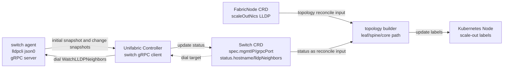
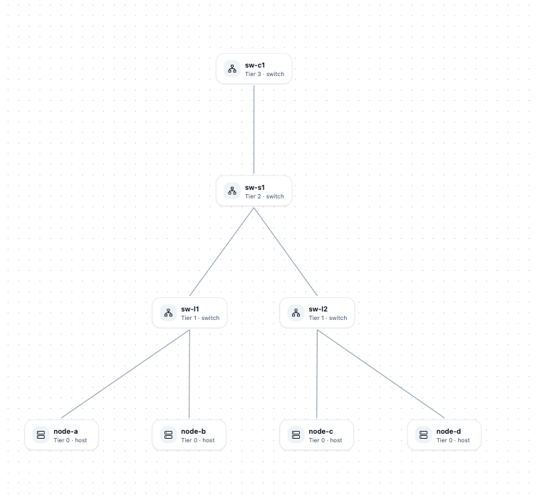

# Scale-Out Topology Discovery Design

中文版本：[scaleout-topology.zh.md](./scaleout-topology.zh.md)

## Summary

This document describes topology discovery for scale-out networks with leaf, spine,
and core tiers. A lightweight switch agent runs on each switch and periodically
collects LLDP neighbor data. The Unifabric Controller establishes long-lived gRPC
subscriptions, receives neighbor snapshots, and writes them into `Switch.status`. The
Controller combines that switch-side data with the host NIC data in `FabricNode`,
computes the full scale-out topology, and writes the result back as Kubernetes Node
labels. In the current version, `Switch` is the switch-side API resource and Node
labels are the scheduling-facing output. No separate group CRD is installed.

## Motivation

AI and ML workloads need heavy Pod-to-Pod communication. Topology data helps the
scheduler place workload Pods onto nodes that are close to each other in the network
fabric, which preserves runtime performance and controls cost.

Before this design, the main input was `FabricNode.status.scaleOutNics`. That data
only tells the Controller which leaf switches connect directly to a given GPU node.
It cannot answer two questions:

1. Which spine and core tiers exist above those leaf switches.
2. How those tiering results map to objects and Node labels that a scheduler can
   consume directly.

That is the boundary of the earlier leaf-only model. It cannot carry spine and core
results, and it cannot express the relationship between switches and nodes. With only
that input, schedulers such as Kueue cannot consume a stable and reusable scale-out
topology model.

This design brings switch-side LLDP neighbor data into the Controller, fills in
switch-to-switch and switch-to-node relationships, and combines them with node-side
input to compute the full scale-out topology. From those inputs, the Controller
generates the leaf, spine, and core Node labels. The design must also keep
implementation complexity under control. It must not give every switch its own
Kubernetes credentials or a complicated per-switch TLS configuration.

User story:

- As a GPU cluster administrator, I want Unifabric to discover leaf, spine, and core
  topology in the scale-out network and write the results into stable Kubernetes Node
  labels, so I can use topology-aware scheduling in systems such as Kueue without
  handling raw LLDP data, switch vendor differences, or multi-hop topology
  calculations.

### Goals

- Identify leaf, spine, and core tiers in the scale-out network of a GPU cluster,
  instead of stopping at leaf-only discovery.
- Continuously write topology results into stable Kubernetes Node labels that
  schedulers such as Kueue consume directly.
- Allow GPU cluster administrators to apply topology-aware scheduling based on those
  labels.
- Keep switch onboarding and certificate operations at an acceptable complexity level.

### Non-Goals

- This phase does not cover topology discovery for scale-up networks or storage
  networks. The scope is scale-out only.
- No scheduler plugin or placement policy is part of this design.

## Proposal

The design has four parts:

1. `unifabric-switch-agent` runs on each switch, periodically collects LLDP neighbor
   data, and exposes full snapshots through a gRPC server.
2. The Controller acts as a gRPC client, subscribes to LLDP snapshots from each
   switch, and writes the result into `Switch.status`.
3. `SwitchTopologyDiscoveryController` takes `FabricNode` and `Switch` as inputs,
   computes the leaf, spine, and core tiers for GPU nodes, and keeps the topology
   groups as an internal projection.
4. The Controller writes the final topology results back to Kubernetes Node labels
   according to `topoDiscovery.scaleOut.nodeLabel.keyTemplate` in the chart.

`SwitchTopologyDiscoveryController` handles scale-out topology discovery and label
reconciliation. No leaf-group CR is installed. The Controller reads dial targets from
`Switch.spec`, establishes secure connections with global pinned mTLS, persists the
returned `switch_name` into `Switch.status.hostname`, and uses that reported hostname
as the alias source when it reconciles switch-side and node-side topology data.

Design constraints recorded at decision time:

- The Controller actively connects to the switch agent gRPC service. This keeps
  connection lifecycle, authentication, and reconnect logic centralized in the
  Controller.
- The transport uses long-lived gRPC connections with a server-streaming RPC. The
  initial connection sends a full snapshot. Later updates send a new full snapshot
  only when LLDP changes.
- Authentication uses global pinned mTLS instead of per-switch certificates. The
  Controller holds one client certificate, the switch agent holds one server
  certificate, and each side validates that the peer certificate matches the expected
  value directly. There are no per-switch Secrets, SNI requirements, or IP SAN
  requirements.
- The current platform priority is NVIDIA Cumulus, NVIDIA SONiC, and community SONiC.
- Internal topology groups represent the performance domains for leaf, spine, and
  core tiers. The tiering semantics follow the network topology layering ideas used
  by Volcano. CIDR-based grouping and a higher-level `Topology` CRD were left as
  future topics at decision time. The `Topology` CRD was later added. See
  [Topology CRD design](./topology-crd.md).

Rollout sequence:

1. Build or publish a matched controller image, node agent image, and switch-agent
   image for the same code revision.
2. Prepare switch-side pinned mTLS materials and deploy `unifabric-switch-agent` to
   every scale-out switch before enabling switch-driven discovery.
3. Create one `Switch` resource per managed scale-out switch, so the Controller has a
   dial target for every switch-agent endpoint.
4. Set `topoDiscovery.scaleOut.mode=unifabric-roce`, so the Controller starts the
   switch-driven scale-out path.
5. Make sure that `Switch.status` becomes healthy and that GPU node labels are written
   from the switch-driven path.

How to deploy the switch agent is in
[the switch-agent deployment guide](../usage/switch-agent-deployment.md).

## Detailed Design

### Overall architecture



### Data sources

There are two categories of input data:

- On the node side, `FabricNode.status.scaleOutNics[*].lldpNeighbor` provides the
  connection between a GPU node and its leaf switches. Only scale-out NICs are used.
  Storage NICs and scale-up NICs are ignored.
- On the switch side, `Switch.status.hostname` carries the switch-reported hostname,
  and `Switch.status.lldpNeighbors` stores aggregated LLDP relationships for
  switch-to-switch and switch-to-node links. That data correlates switch aliases,
  classifies remote peers, and identifies the spine and core tiers above each leaf.

### Switch agent

Each switch runs `unifabric-switch-agent`. It needs no Kubernetes permissions. Its
only job is to collect local LLDP neighbor snapshots and expose a gRPC stream that the
Controller subscribes to. The core flow is:

1. Parse configuration: the local hostname, management IP, gRPC listen address, server
   certificate and private key, the expected Controller client certificate, and the
   collection interval.
2. Periodically enter the host mount and network namespaces and run the host
   `lldpcli`:

```bash
nsenter --mount=/host/proc/1/ns/mnt --net=/host/proc/1/ns/net -- lldpcli show neighbors -f json0
```

3. Compare the result with the previous snapshot and generate a new full snapshot if
   LLDP changed.
4. Expose a gRPC server and wait for the Controller to establish a subscription.
5. After the Controller connects, return the current full snapshot first, then push
   new full snapshots on the same stream whenever LLDP changes.
6. After the stream disconnects, the Controller reconnects with exponential backoff.
   The agent does not buffer incremental events.

The agent only sends full snapshots, never deltas. The Controller treats each message
as the current full neighbor view of that switch. It needs no deletion logic and no
handling of out-of-order incremental updates.

### gRPC subscription interface

The switch agent exposes a dedicated gRPC server. The Controller maintains one
long-lived connection per switch. The global fallback port, port filters, and pinned
mTLS mode are configured through Helm values. Transport tuning uses Controller
defaults. Each switch provides its dial target in `Switch.spec`.

```yaml
switchSubscription:
  defaultGrpcPort: 8090
  ignorePortPatterns:
    - mgmt*
    - Management*
    - oob*
  mtls:
    mode: auto
    controllerSecretName: switch-controller-mtls-controller
    switchAgentSecretName: switch-controller-mtls-agent
```

`controllerSecretName` and `switchAgentSecretName` are not two copies of the same
certificate. They store the mTLS identity materials for the Controller and the switch
agent separately. Technically, one Secret can hold both private keys. The design
intentionally splits the bundles, so exporting switch-agent certificates to a switch
does not also export the Controller private key outside the cluster.

The Controller applies `ignorePortPatterns` before it writes `Switch.status` and
before it builds the topology graph. The switch agent always reports full LLDP
snapshots. Connection timeouts, reconnect backoff, keepalive, receive limits, and
generated-certificate validity use Controller and chart defaults, not public Helm
values.

#### Subscription service

The service is a dedicated proto:

```proto
service SwitchReporter {
  rpc WatchLLDPNeighbors(WatchLLDPNeighborsRequest) returns (stream LLDPNeighborSnapshot);
}

message WatchLLDPNeighborsRequest {
  string expected_switch_name = 1;
}

message LLDPNeighborSnapshot {
  string switch_name = 1;
  repeated LLDPNeighbor lldp_neighbors = 2;
  uint64 generation = 3;
}

message LLDPNeighbor {
  string local_device_name = 1;
  string local_port = 2;
  string remote_system_name = 3;
  string remote_port_id = 4;
}
```

Subscription semantics:

- The Controller reads `spec.mgmtIP` and the optional `spec.grpcPort` from each switch
  through list/watch on `Switch` resources and uses them to establish the connection.
- When `spec.mgmtIP` is empty, the Controller starts no subscription stream for that
  switch.
- The dial target is `spec.mgmtIP:spec.grpcPort`. If `grpcPort` is empty, the global
  `defaultGrpcPort` is used.
- `metadata.name` does not have to match the switch-reported hostname. The Controller
  persists the returned `switch_name` into `Switch.status.hostname` and uses that
  reported hostname as the alias source during topology reconciliation.
- If `Switch.spec.mgmtIP` or `Switch.spec.grpcPort` changes, the Controller must close
  the old connection and rebuild the subscription with the new configuration.
- `expected_switch_name` is an optional request field. The current Controller leaves
  it empty. When a caller sets it, the agent validates it against the local switch
  hostname and can return `FailedPrecondition` on mismatch.
- After the agent accepts the connection, it immediately returns the current full
  snapshot and later pushes a new full snapshot whenever LLDP changes.
- `lldp_neighbors` is a structured array, not a pass-through of raw `lldpcli json0`
  output.
- Each neighbor entry contains at least `local_device_name`, `local_port`,
  `remote_system_name`, and `remote_port_id`.
- `switch_name` must match `local_device_name` in each neighbor entry, or both must
  normalize to the same DNS-1123 name.
- `generation` increases monotonically per switch, so the Controller can drop
  duplicate or out-of-order snapshots.

Interface constraints:

- Use a server-streaming RPC. The Controller connects, and the agent pushes snapshots
  on the stream.
- Every message represents the current full LLDP neighbor view of the switch. The
  Controller overwrites the old state directly.
- The Controller client must set `maxRecvMsgSize`, and the agent server must set a
  matching send limit, so large switch neighbor tables are not rejected by default
  size limits.
- When there is no LLDP change, no empty snapshot is sent. Link liveness relies on
  gRPC keepalive and Controller-side reconnect behavior.
- If the Controller later needs to send debugging commands or dynamic filters on the
  same connection, the API can extend to bidirectional streaming. That is out of scope
  for this design.

#### Authentication and exposure

This design uses global pinned mTLS:

- By default, the chart auto-generates two sets of pinned mTLS identity materials: one
  for the Controller as the client certificate and private key, and one for the switch
  agent as the server certificate and private key. The validity period is `106751`
  days, the largest whole-day value that fits the Go `time.Duration` calculation used
  by Helm/Sprig (about `292` years).
- When auto-generation is enabled, the chart uses Helm certificate helpers during
  installation to generate the two pinned certificate bundles and uses `lookup` to
  reuse existing Helm-owned Secrets, so `helm upgrade` does not reissue certificates
  on every render.
- The Controller loads its own client certificate, private key, and the expected
  switch-agent server certificate from `mtls.controllerSecretName`. The Secret must
  include `tls.crt`, `tls.key`, and `peer.crt`.
- The switch agent loads its own server certificate, private key, and the expected
  Controller client certificate from the bundle referenced by
  `mtls.switchAgentSecretName`. That bundle must also include `tls.crt`, `tls.key`,
  and `peer.crt`.
- The chart mounts the Controller-side Secret directly. The switch-agent certificate
  bundle is generated by the chart and then exported with `kubectl get secret`, so it
  can be copied to each switch.
- The design intentionally uses two Secrets instead of putting both private keys into
  one Secret. The switch side only needs the switch-agent private key and must not
  receive the Controller private key.
- No serverName, SNI, or IP SAN is required, and the `Switch` resource stores no
  per-switch Secret or TLS fields.
- In this model, all switch agents can share the same server certificate. TLS only
  proves that the peer is a valid switch agent or Controller. It does not prove which
  device it is. The current implementation therefore relies on the reported
  `switch_name` written to `Switch.status.hostname` for topology alias resolution. If
  stricter device identity pinning is needed later, the optional
  `expected_switch_name` check can be enabled.
- If the management network is trusted and plaintext gRPC is needed temporarily for
  development or debugging, mTLS can be disabled. That is not the default deployment
  mode.
- If the organization already has a certificate infrastructure, set
  `mtls.mode=existing` and provide the existing `controllerSecretName` and
  `switchAgentSecretName`. Use `mtls.mode=disabled` only for trusted development
  environments that require plaintext gRPC.

If finer-grained device identity is needed later, the design can evolve to per-switch
certificates or switch to a standard CA + SAN TLS model.

### Switch resource model

`Switch` is a cluster-scoped resource that represents a physical switch. `spec.mgmtIP`
and `spec.grpcPort` optionally describe where the Controller connects. A Switch
without `mgmtIP` starts no subscription. It can enrich
`Topology.status.domains[*].members` through a `domain` label, or supply manual
switch-to-switch adjacency through the `unifabric.io/switch-neighbors` annotation. For
each effective role, annotation-key presence selects the topology source: if any
Switch omits the key, discovery uses switch-reported LLDP and ignores every
manual-neighbor annotation. If every Switch has the key, discovery uses those
annotations together with node-discovered synthetic leaves and ignores switch-reported
neighbors. Per-switch authentication materials are not stored in the resource. Global
Controller and agent settings handle authentication and TLS. When a subscription is
configured, the Controller refreshes `status` continuously, stores the reported switch
hostname separately from the Kubernetes resource name, and keeps aggregated LLDP
neighbors grouped by remote system. The switch agent never writes Kubernetes API
objects directly. The current field reference is
[Switch reference](../reference/switch.md).

Example:

```yaml
apiVersion: unifabric.io/v1beta1
kind: Switch
metadata:
  name: rack-a-leaf1
spec:
  mgmtIP: 10.0.0.11
  grpcPort: 8090
status:
  hostname: leaf1
  healthy: true
  conditions:
    - type: Connected
      status: "True"
      reason: StreamReady
      message: Controller is receiving LLDP snapshots from switch agent
  lldpNeighborCount: 2
  lldpNeighbors:
    - remoteSystemType: KubernetesNode
      remoteSystemName: node-a
    - remoteSystemType: Switch
      remoteSystemName: spine1
```

Designed fields:

| Field | Meaning |
| --- | --- |
| `metadata.name` | Switch resource name. It must be unique in the cluster, but it does not have to match the switch-reported hostname. |
| `metadata.annotations[unifabric.io/switch-neighbors]` | JSON string array that contains only directly connected switches. Kubernetes Node names are forbidden. When the key exists on every Switch of a role, it selects semi-automatic topology. Key presence counts even when the value is empty or `[]`. |
| `spec.mgmtIP` | Optional. Switch management IP used as the dial target. When omitted, no switch-agent subscription is started. |
| `spec.grpcPort` | Optional. If the switch gRPC server port is not set, the global `defaultGrpcPort` is used. |
| `status.hostname` | The switch-reported hostname from the latest accepted snapshot. It is the alias source when the Controller matches switch-side data with node-side LLDP hostnames. |
| `status.healthy` | Whether the current observed switch state is healthy, based on connection state, authentication result, and snapshot freshness. |
| `status.conditions` | Connection state and data readiness state, such as `Connected` and `Ready`. |
| `status.lldpNeighborCount` | The number of aggregated remote-system entries in `lldpNeighbors`, for quick visibility and troubleshooting. |
| `status.lldpNeighbors` | Unique remote neighbors observed for this switch. |
| `status.lldpNeighbors[*].remoteSystemType` | Whether the remote system resolves to a Kubernetes Node or another switch. |
| `status.lldpNeighbors[*].remoteSystemName` | The remote host or switch name for this neighbor entry. |

A label-only Switch uses `unifabric.io/domain: <domain-name>`. The value must exactly
match a domain already produced from Node topology labels. Leaf, spine, and core all
use this same key. `spec.role: ScaleOut` selects the fabric, and the Controller infers
the tier from the matched domain.

#### Manual switch adjacency without switch-side LLDP

In the built-in RoCE discovery mode, host LLDP supplies Node-to-leaf links. For
semi-automatic discovery, operators create only the higher-layer Switch resources and
put the `unifabric.io/switch-neighbors` key on every one of them. Node LLDP creates
synthetic leaf switches, and the annotations connect those leaves to the declared
upper layer. If any Switch of the same effective role omits the key, the Controller
selects fully automatic switch discovery and ignores all neighbor annotations.

```yaml
apiVersion: unifabric.io/v1beta1
kind: Switch
metadata:
  name: spine1
  annotations:
    unifabric.io/switch-neighbors: '["leaf1", "leaf2"]'
spec:
  role: ScaleOut
```

The annotation is a quoted JSON string array because Kubernetes annotations are
strings. Every entry is a switch neighbor. Kubernetes Node names are not allowed. A
neighbor can name either a synthetic leaf switch discovered from FabricNode LLDP or
another annotated Switch with the same effective role. FabricNode LLDP supplies
Node-to-switch links separately, so those Node names must not repeat here. One
endpoint is sufficient because discovery treats the link as undirected. Duplicate
declarations are deduplicated. Empty names, self-references, malformed JSON, and
unresolved references stop that reconciliation and preserve the existing topology
labels. The annotation key itself selects semi-automatic mode, so an empty value and
`[]` still count as present. `spec.mgmtIP`, the gRPC fields, and
`status.lldpNeighbors` are not required or used for topology input in this mode.

### Topology computation flow

`SwitchTopologyDiscoveryController` computes the leaf, spine, and core topology
groups, maintains the topology tiers, and writes labels back to Nodes. It is the only
Unifabric writer for scale-out topology labels.

The controller reconciles on these events:

1. `FabricNode` create, delete, or status change.
2. `Switch` create, delete, or status change.
3. Periodic resync, to recompute topology and compensate for missed events.
4. Controller restart after configuration changes.

Each reconcile performs these steps:

1. List all `FabricNode` objects.
2. List all `Switch` objects.
3. Partition switches by `Switch.spec.role` and build one topology graph per role.
4. Compute leaf, spine, and core topology groups for each role-specific graph.
5. Update topology labels on the Kubernetes Nodes from the `ScaleOut` graph.



### Topology label naming

Writing results back to Kubernetes Nodes has two parts: the label key and the label
value. The scale-out writer and the label key template are configured together:

```yaml
topoDiscovery:
  scaleOut:
    mode: unifabric-roce
    nodeLabel:
      keyTemplate: "scale-out.unifabric.io/tier-{{ .Tier }}"
```

The template can be customized per cluster. Tier 1 is closest to the Node, and higher
tiers increment without a fixed maximum. Built-in discovery assigns stable values in
`tier${N}-group${M}` form. Existing assignments are locked during ordinary
reconciliation: the Controller fills missing labels and does not rename or remove an
existing assignment. Logs, metrics, and the `Topology/scaleout` status retain the
relationship between each performance domain and its Switch members (see
[Topology CRD design](./topology-crd.md)).

### RBAC and permissions

The Controller needs these additional permissions:

```yaml
- apiGroups: ["unifabric.io"]
  resources: ["switches"]
  verbs: ["get", "list", "watch", "create", "update", "patch", "delete"]
- apiGroups: ["unifabric.io"]
  resources: ["switches/status"]
  verbs: ["get", "update", "patch"]
- apiGroups: [""]
  resources: ["nodes"]
  verbs: ["get", "list", "watch", "patch", "update"]
```

### Observability

The Controller exposes these metrics:

| Metric | Type | Meaning |
| --- | --- | --- |
| `unifabric_switch_count` | Gauge | The number of switches currently managed by the control plane and included in topology computation. |
| `unifabric_switch_lldp_parse_success_total` | Counter | The number of times the Controller successfully parsed and accepted LLDP neighbor data reported by switches. |
| `unifabric_switch_lldp_parse_failure_total` | Counter | The number of times the Controller failed to parse or validate LLDP neighbor data from switches, including missing fields, malformed input, or validation failure. |

Logs must include:

- Subscription and neighbor update summaries per switch: switch name, peer address,
  generation, and link count.
- Topology computation summaries: the number of switches, nodes, links, topology
  groups, and Node label updates.

### Test plan

Unit tests:

- The switch-side LLDP JSON0 parser, covering missing fields and case normalization.
- Proto encode and decode, plus generation deduplication and out-of-order snapshot
  handling.
- Configuration tests that make sure that the Controller processes the switch-driven
  path when switch-driven discovery is enabled.
- Tests that `Switch.spec.mgmtIP` and `spec.grpcPort` changes trigger a redial.
- Topology graph building, topology group projection, and Node label reconciliation.

End-to-end tests:

- When switch-driven discovery is enabled, leaf labels are generated by the
  switch-driven path.
- The Controller establishes a gRPC stream with the switch agent and writes the
  initial full snapshot into `Switch.status`.
- Helm-generated pinned mTLS Secrets do not rotate unexpectedly after `helm upgrade`
  because of template re-rendering.
- GPU Node topology labels are rendered from
  `topoDiscovery.scaleOut.nodeLabel.keyTemplate` and use stable `tier${N}-group${M}`
  values.
- A simulated switch-agent stop or gRPC stream disconnection produces correct
  reconnect behavior and topology result updates.

### Acceptance criteria

The capability must satisfy at least these conditions:

- Leaf, spine, and core scale-out topology results are expressed through Node labels.
- The Controller maintains stable gRPC subscription connections to switches and
  recovers automatically after disconnections.
- `Switch.status` continuously reflects the latest LLDP snapshot, connection state,
  and health state.
- GPU nodes on the target platform receive the correct leaf, spine, and core labels.
- Auto-generated pinned mTLS certificates do not rotate unexpectedly across install,
  upgrade, and recovery workflows.

## Risks and Mitigations

- If the long-lived connection breaks or switch-side collection fails, the neighbor
  data in `Switch.status` becomes stale and delays Node label updates. Mitigation:
  exponential backoff reconnects and periodic resyncs on the Controller side, plus
  data freshness and connection state exposed through `status.healthy` and conditions.
- Global pinned mTLS proves the peer role but not the specific device identity. The
  current implementation mitigates topology correlation by persisting the returned
  `switch_name` into `Switch.status.hostname` and using that reported hostname as the
  alias source. If stricter device identity pinning is required later, the optional
  `expected_switch_name` request field can be enabled to reject mismatches.
- Very large switch neighbor tables can produce oversized messages or CRD bloat.
  Mitigation: set `maxRecvMsgSize` explicitly on both sides of gRPC and store only
  the structured neighbor table, not the full raw JSON.
- Auto-generated certificates can rotate unexpectedly during `helm upgrade`.
  Mitigation: the chart reuses Helm-owned Secrets through `lookup` when
  auto-generation is enabled, instead of re-issuing them on every render.
- The design requires deploying and operating `unifabric-switch-agent` on each
  switch. This operational cost was accepted as a known drawback.

## Alternatives

- Retrieve LLDP data through gNMI instead of a switch agent. Rejected because vendor
  support is inconsistent.
- The remaining items are reconstructed from decisions this design argues against.
  They were not recorded at decision time:
  - The switch agent writes Kubernetes API objects directly. Rejected because every
    switch then needs Kubernetes credentials, and connection and authentication
    logic spreads across devices. The Controller-dials-out model keeps
    credentials and lifecycle in one place.
  - Per-switch certificates with SNI or IP SANs. Rejected for operational complexity:
    per-switch Secrets and certificate distribution do not match the acceptable
    onboarding cost. Global pinned mTLS with the optional `expected_switch_name`
    check was chosen instead.
  - A dedicated leaf-group or topology-group CRD as the scheduler-facing output.
    Rejected for this phase because schedulers such as Kueue consume Node labels
    directly. Topology groups stay an internal projection. A higher-level `Topology`
    CRD was added later for read-only viewing.

## Implementation History

- 2026-05-26: Switch-driven scale-out topology discovery and labels implemented.
- 2026-07-17: Updated together with topology status aggregation and automatic label
  discovery. The `Topology` CRD now exposes the read-only aggregated view.
- 2026-10-13: Document restructured into the design template. Parts of the
  Alternatives section are a post-hoc reconstruction.
