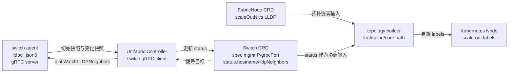

# 横向扩展（Scale-Out）拓扑发现设计

English version: [scaleout-topology.md](./scaleout-topology.md)

## 概要

本文描述针对含 leaf、spine、core 层级的 scale-out 网络的拓扑发现设计。每台交换机上运行一个
轻量的 switch agent，周期性采集 LLDP 邻居数据。Unifabric Controller 建立长连接 gRPC 订阅，
接收邻居快照并写入 `Switch.status`。Controller 把交换机侧数据与 `FabricNode` 中的主机网卡
数据结合，计算完整的 scale-out 拓扑，并把结果以 Kubernetes Node labels 的形式写回。在当前
版本中，`Switch` 是交换机侧的 API 资源，Node labels 是面向调度的输出。不安装独立的分组 CRD。

## 动机

AI 和 ML 工作负载需要大量 Pod 间通信。拓扑数据帮助调度器把工作负载 Pod 放到网络上彼此接近
的节点，从而保证运行性能并控制成本。

在本设计之前，主要输入是 `FabricNode.status.scaleOutNics`。该数据只能告诉 Controller 某个
GPU 节点直连了哪些 leaf 交换机。它回答不了两个问题：

1. 这些 leaf 交换机之上存在哪些 spine 和 core 层级。
2. 这些分层结果如何写入调度器可以直接消费的对象和 Node labels。

这也是早期 leaf-only 模型的边界。它承载不了 spine 和 core 的结果，也表达不了交换机和节点的
关系。只靠这一条输入路径，Kueue 等调度器仍然无法消费稳定、可复用的 scale-out 拓扑模型。

本设计把交换机侧 LLDP 邻居数据引入 Controller，补全交换机到交换机、交换机到节点的关系，
并与节点侧输入结合，计算完整的 scale-out 拓扑。基于这些输入，Controller 生成对应的 leaf、
spine、core Node labels。同时，方案必须把实现复杂度控制在可接受范围内，不给每台交换机单独的
Kubernetes 凭据，也不引入复杂的按交换机 TLS 配置。

用户故事：

- 作为 GPU 集群管理员，我希望 Unifabric 自动发现 scale-out 网络的 leaf、spine、core 拓扑，
  并把结果写入稳定的 Kubernetes Node labels，这样我可以在 Kueue 等系统中使用拓扑感知调度，
  而不用直接处理原始 LLDP 数据、交换机厂商差异或多跳拓扑计算。

### 目标

- 识别 GPU 集群 scale-out 网络中的 leaf、spine、core 层级，而不是停留在 leaf-only 发现。
- 持续把拓扑结果写入稳定的 Kubernetes Node labels，供 Kueue 等调度器直接消费。
- 让 GPU 集群管理员基于这些 labels 做拓扑感知调度。
- 把交换机接入和证书运维的复杂度控制在可接受水平。

### 非目标

- 本阶段不覆盖 scale-up 网络和存储网络的拓扑发现，范围仅限 scale-out。
- 本设计不包含调度器插件或放置策略。

## 方案

设计分四部分：

1. `unifabric-switch-agent` 运行在每台交换机上，周期性采集 LLDP 邻居数据，通过 gRPC server
   暴露全量快照。
2. Controller 作为 gRPC 客户端，向每台交换机订阅 LLDP 快照，把结果写入 `Switch.status`。
3. `SwitchTopologyDiscoveryController` 以 `FabricNode` 和 `Switch` 为输入，计算 GPU 节点的
   leaf、spine、core 层级，并把拓扑分组保存为内部投影。
4. Controller 按 chart 中的 `topoDiscovery.scaleOut.nodeLabel.keyTemplate` 把最终拓扑结果
   写回 Kubernetes Node labels。

scale-out 拓扑发现和 label 协调由 `SwitchTopologyDiscoveryController` 负责，不安装
leaf-group CR。Controller 从 `Switch.spec` 获取拨号目标，用全局固定（pinned）mTLS 建立安全
连接，把返回的 `switch_name` 持久化到 `Switch.status.hostname`，并在协调交换机侧和节点侧
拓扑数据时把该上报主机名作为别名来源。

决策时记录的设计约束：

- Controller 主动连接 switch agent 的 gRPC 服务。连接生命周期、认证和重连逻辑集中在
  Controller。
- 传输使用长连接 gRPC，采用 server-streaming RPC。初次连接发送全量快照，之后只在 LLDP
  变化时发送新的全量快照。
- 认证使用全局固定 mTLS，而不是按交换机证书。Controller 持有一份客户端证书，switch agent
  持有一份服务端证书，双方直接校验对端证书是否与预期一致。没有按交换机的 Secret、SNI 要求
  或 IP SAN 要求。
- 当前平台优先级是 NVIDIA Cumulus、NVIDIA SONiC 和社区 SONiC。
- 内部拓扑分组表示 leaf、spine、core 层级的性能域。分层语义沿用 Volcano 的网络拓扑分层思路。
  是否需要基于 CIDR 的分组、是否需要更高层的 `Topology` CRD，在决策时留作后续演进。
  `Topology` CRD 后来已经加入，见 [Topology CRD 设计](./topology-crd.md)。

上线顺序：

1. 为同一代码版本构建或发布配套的 controller 镜像、node agent 镜像和 switch-agent 镜像。
2. 准备交换机侧固定 mTLS 材料，在启用交换机驱动发现前，把 `unifabric-switch-agent` 部署到
   每台 scale-out 交换机。
3. 为每台受管 scale-out 交换机创建一个 `Switch` 资源，让 Controller 拿到每个 switch-agent
   端点的拨号目标。
4. 设置 `topoDiscovery.scaleOut.mode=unifabric-roce`，让 Controller 启动交换机驱动的
   scale-out 路径。
5. 确认 `Switch.status` 变为健康，且 GPU 节点 labels 由交换机驱动路径写入。

switch agent 的部署方法见[交换机 agent 部署指南](../usage/switch-agent-deployment.md)。

## 详细设计

### 整体架构



### 数据来源

输入数据分两类：

- 节点侧：`FabricNode.status.scaleOutNics[*].lldpNeighbor` 提供 GPU 节点与其 leaf 交换机的
  连接关系。只使用 scale-out 网卡，忽略存储网卡和 scale-up 网卡。
- 交换机侧：`Switch.status.hostname` 携带交换机上报的主机名，`Switch.status.lldpNeighbors`
  保存交换机到交换机、交换机到节点链路的聚合 LLDP 关系。这些数据用于关联交换机别名、分类
  远端对象，以及识别每个 leaf 之上的 spine 和 core 层级。

### Switch agent

每台交换机运行 `unifabric-switch-agent`。它不需要任何 Kubernetes 权限，唯一职责是采集本地
LLDP 邻居快照，并暴露供 Controller 订阅的 gRPC 流。核心流程：

1. 解析配置：本地主机名、管理 IP、gRPC 监听地址、服务端证书与私钥、预期的 Controller
   客户端证书，以及采集间隔。
2. 周期性进入主机 mount 和网络命名空间，执行主机上的 `lldpcli`：

```bash
nsenter --mount=/host/proc/1/ns/mnt --net=/host/proc/1/ns/net -- lldpcli show neighbors -f json0
```

3. 与上一次快照比较，LLDP 变化时生成新的全量快照。
4. 暴露 gRPC server，等待 Controller 建立订阅。
5. Controller 连接后先返回当前全量快照，之后每当 LLDP 变化就在同一条流上推送新的全量快照。
6. 流断开后由 Controller 以指数退避重连。agent 不需要缓存增量事件。

agent 只发送全量快照，不发送增量。Controller 把每条消息当作该交换机当前的完整邻居视图，
不需要删除逻辑，也不需要处理乱序的增量更新。

### gRPC 订阅接口

switch agent 暴露独立的 gRPC server。Controller 对每台交换机维护一条长连接。全局兜底端口、
端口过滤和固定 mTLS 模式通过 Helm values 配置，传输调优使用 Controller 默认值。每台交换机
在 `Switch.spec` 中提供拨号目标。

```yaml
switchSubscription:
  defaultGrpcPort: 8090
  ignorePortPatterns:
    - mgmt*
    - Management*
    - oob*
  mtls:
    mode: auto
    controllerSecretName: switch-controller-mtls-controller
    switchAgentSecretName: switch-controller-mtls-agent
```

`controllerSecretName` 和 `switchAgentSecretName` 不是同一份证书的两个副本。它们分别保存
Controller 和 switch agent 的 mTLS 身份材料。技术上两把私钥可以放进一个 Secret，但设计有意
拆分证书包：把 switch-agent 证书导出到交换机时，不会把 Controller 私钥也带出集群。

Controller 在写 `Switch.status` 之前、构建拓扑图之前应用 `ignorePortPatterns`。switch agent
始终上报全量 LLDP 快照。连接超时、重连退避、keepalive、接收上限和自动生成证书的有效期使用
Controller 和 chart 的默认值，不作为公开 Helm values。

#### 订阅服务

服务定义为独立的 proto：

```proto
service SwitchReporter {
  rpc WatchLLDPNeighbors(WatchLLDPNeighborsRequest) returns (stream LLDPNeighborSnapshot);
}

message WatchLLDPNeighborsRequest {
  string expected_switch_name = 1;
}

message LLDPNeighborSnapshot {
  string switch_name = 1;
  repeated LLDPNeighbor lldp_neighbors = 2;
  uint64 generation = 3;
}

message LLDPNeighbor {
  string local_device_name = 1;
  string local_port = 2;
  string remote_system_name = 3;
  string remote_port_id = 4;
}
```

订阅语义：

- Controller 通过对 `Switch` 资源的 list/watch 读取每台交换机的 `spec.mgmtIP` 和可选的
  `spec.grpcPort`，用它们建立 gRPC 连接。
- `spec.mgmtIP` 为空时，Controller 不为该交换机建立订阅流。
- 实际拨号目标是 `spec.mgmtIP:spec.grpcPort`。`grpcPort` 为空时使用全局 `defaultGrpcPort`。
- `metadata.name` 不必与交换机上报的主机名一致。Controller 把返回的 `switch_name` 持久化到
  `Switch.status.hostname`，并在拓扑协调时把该上报主机名作为别名来源。
- `Switch.spec.mgmtIP` 或 `Switch.spec.grpcPort` 变化时，Controller 必须关闭旧连接，用新
  配置重建订阅。
- `expected_switch_name` 是可选请求字段。当前 Controller 留空。调用方设置后，agent 用本地
  交换机主机名校验，不匹配时可以返回 `FailedPrecondition`。
- agent 接受连接后立即返回当前全量快照，之后每当 LLDP 变化推送新的全量快照。
- `lldp_neighbors` 是结构化数组，不透传原始 `lldpcli json0` 输出。
- 每个邻居条目至少包含 `local_device_name`、`local_port`、`remote_system_name` 和
  `remote_port_id`。
- `switch_name` 必须与每个邻居条目中的 `local_device_name` 一致，或两者归一化为同一个
  DNS-1123 名称。
- `generation` 按交换机单调递增，Controller 据此丢弃重复或乱序快照。

接口约束：

- 使用 server-streaming RPC。Controller 主动连接，agent 在流上推送快照。
- 每条消息代表该交换机当前的完整 LLDP 邻居视图，Controller 直接覆盖旧状态。
- Controller 客户端必须设置 `maxRecvMsgSize`，agent 服务端必须设置匹配的发送上限，避免
  大型邻居表被默认大小限制拒绝。
- LLDP 无变化时不发送空快照。链路存活依赖 gRPC keepalive 和 Controller 侧的重连行为。
- 如果 Controller 之后需要在同一连接上发送调试命令或动态过滤器，API 可以扩展为双向流，
  但不在本设计范围内。

#### 认证与暴露

本设计使用全局固定 mTLS：

- 默认情况下，chart 自动生成两套固定 mTLS 身份材料：一套作为 Controller 的客户端证书和私钥，
  一套作为 switch agent 的服务端证书和私钥。有效期为 `106751` 天，这是 Helm/Sprig 使用的
  Go `time.Duration` 计算所能容纳的最大整天数（约 `292` 年）。
- 启用自动生成时，chart 在安装时用 Helm 证书辅助函数生成两个固定证书包，并用 `lookup`
  复用已有的 Helm 所属 Secret，`helm upgrade` 不会在每次渲染时重新签发证书。
- Controller 从 `mtls.controllerSecretName` 加载自己的客户端证书、私钥和预期的 switch-agent
  服务端证书。该 Secret 必须包含 `tls.crt`、`tls.key` 和 `peer.crt`。
- switch agent 从 `mtls.switchAgentSecretName` 引用的证书包加载自己的服务端证书、私钥和
  预期的 Controller 客户端证书。该证书包同样必须包含 `tls.crt`、`tls.key` 和 `peer.crt`。
- Controller 侧 Secret 由 chart 直接挂载。switch-agent 证书包由 chart 生成，再用
  `kubectl get secret` 导出，拷贝到每台交换机。
- 设计有意使用两个 Secret，而不是把两把私钥放进一个 Secret。交换机侧只需要 switch-agent
  私钥，不能拿到 Controller 私钥。
- 不要求 serverName、SNI 或 IP SAN，`Switch` 资源不保存按交换机的 Secret 或 TLS 字段。
- 在该模型下，所有 switch agent 可以共享同一份服务端证书。TLS 只证明对端是合法的 switch
  agent 或 Controller，不证明具体是哪台设备。因此当前实现依赖写入
  `Switch.status.hostname` 的上报 `switch_name` 做拓扑别名解析。如果之后需要更严格的设备
  身份固定，可以启用可选的 `expected_switch_name` 校验。
- 如果管理网可信且开发调试需要临时明文 gRPC，可以关闭 mTLS，但这不是默认部署模式。
- 如果组织已有证书基础设施，设置 `mtls.mode=existing` 并提供现有的 `controllerSecretName`
  和 `switchAgentSecretName`。`mtls.mode=disabled` 只用于需要明文 gRPC 的可信开发环境。

如果之后需要更细粒度的设备身份，设计可以演进为按交换机证书，或改回标准 CA + SAN 的 TLS
模型。

### Switch 资源模型

`Switch` 是表示物理交换机的集群级资源。`spec.mgmtIP` 和 `spec.grpcPort` 可选地描述
Controller 的连接目标。没有 `mgmtIP` 的 Switch 不会启动订阅。它可以通过 `domain` label
补充 `Topology.status.domains[*].members`，或通过 `unifabric.io/switch-neighbors`
annotation 提供手工的交换机邻接关系。对每个有效角色，annotation key 是否存在决定拓扑来源：
只要有一个 Switch 缺少该 key，发现就使用交换机上报的 LLDP 并忽略所有手工邻接 annotation；
如果每个 Switch 都带该 key，发现就使用这些 annotation 加上由节点发现的合成 leaf，并忽略
交换机上报的邻居。按交换机的认证材料不保存在资源中，认证和 TLS 由全局 Controller 和 agent
设置处理。配置了订阅时，Controller 持续刷新 `status`，把上报的交换机主机名与 Kubernetes
资源名分开保存，并按远端系统聚合 LLDP 邻居。switch agent 从不直接写 Kubernetes API 对象。
当前字段以 [Switch 参考手册](../reference/switch.md)为准。

示例：

```yaml
apiVersion: unifabric.io/v1beta1
kind: Switch
metadata:
  name: rack-a-leaf1
spec:
  mgmtIP: 10.0.0.11
  grpcPort: 8090
status:
  hostname: leaf1
  healthy: true
  conditions:
    - type: Connected
      status: "True"
      reason: StreamReady
      message: Controller is receiving LLDP snapshots from switch agent
  lldpNeighborCount: 2
  lldpNeighbors:
    - remoteSystemType: KubernetesNode
      remoteSystemName: node-a
    - remoteSystemType: Switch
      remoteSystemName: spine1
```

设计字段：

| 字段 | 含义 |
| --- | --- |
| `metadata.name` | Switch 资源名。集群内必须唯一，但不必与交换机上报的主机名一致。 |
| `metadata.annotations[unifabric.io/switch-neighbors]` | 只包含直连交换机的 JSON 字符串数组；禁止 Kubernetes Node 名。当某角色的所有 Switch 都带该 key 时选择半自动拓扑；值为空或 `[]` 也算存在。 |
| `spec.mgmtIP` | 可选。作为拨号目标的交换机管理 IP。省略时不启动 switch-agent 订阅。 |
| `spec.grpcPort` | 可选。交换机 gRPC 端口未设置时使用全局 `defaultGrpcPort`。 |
| `status.hostname` | 最近一次接受的快照中交换机上报的主机名。Controller 匹配交换机侧数据与节点侧 LLDP 主机名时的别名来源。 |
| `status.healthy` | 基于连接状态、认证结果和快照新鲜度判断当前观测到的交换机状态是否健康。 |
| `status.conditions` | 连接状态和数据就绪状态，例如 `Connected` 和 `Ready`。 |
| `status.lldpNeighborCount` | `lldpNeighbors` 中聚合的远端系统条目数，便于快速查看和排障。 |
| `status.lldpNeighbors` | 该交换机观测到的去重远端邻居。 |
| `status.lldpNeighbors[*].remoteSystemType` | 远端系统解析为 Kubernetes Node 还是另一台交换机。 |
| `status.lldpNeighbors[*].remoteSystemName` | 该邻居条目的远端主机或交换机名。 |

只带 label 的 Switch 使用 `unifabric.io/domain: <domain-name>`。值必须与已从 Node 拓扑
labels 产出的性能域完全一致。leaf、spine、core 使用同一个 key。`spec.role: ScaleOut` 选择
网络，Controller 从匹配到的性能域推断层级。

#### 无交换机侧 LLDP 的手工邻接

在内置 RoCE 发现模式中，主机 LLDP 提供 Node 到 leaf 的链路。半自动发现时，运维人员只创建
上层的 Switch 资源，并在每一个上放 `unifabric.io/switch-neighbors` key。节点 LLDP 生成
合成 leaf 交换机，annotation 把这些 leaf 连接到声明的上层。如果同一有效角色下有任何 Switch
缺少该 key，Controller 改为选择全自动交换机发现，忽略所有邻接 annotation。

```yaml
apiVersion: unifabric.io/v1beta1
kind: Switch
metadata:
  name: spine1
  annotations:
    unifabric.io/switch-neighbors: '["leaf1", "leaf2"]'
spec:
  role: ScaleOut
```

annotation 是带引号的 JSON 字符串数组，因为 Kubernetes annotation 是字符串。每个条目都是
交换机邻居，不允许 Kubernetes Node 名。邻居可以指向由 FabricNode LLDP 发现的合成 leaf
交换机，也可以指向另一台带 annotation 的同角色 Switch。FabricNode LLDP 单独提供 Node 到
交换机的链路，因此 Node 名不能在这里重复。发现把链路视为无向，声明一端即可；重复声明会被
去重。空名称、自引用、非法 JSON 和无法解析的引用会终止本轮协调并保留现有拓扑 labels。
annotation key 本身选择半自动模式，值为空和 `[]` 也算存在。该模式下 `spec.mgmtIP`、gRPC
字段和 `status.lldpNeighbors` 不是必需的，也不作为拓扑输入。

### 拓扑计算流程

`SwitchTopologyDiscoveryController` 计算 leaf、spine、core 拓扑分组，维护拓扑层级，并把
labels 写回 Node。它是 scale-out 拓扑 labels 的唯一 Unifabric 写入方。

控制器在以下事件时协调：

1. `FabricNode` 创建、删除或 status 变化。
2. `Switch` 创建、删除或 status 变化。
3. 周期性 resync，重算拓扑并补偿漏掉的事件。
4. 配置变更后的 Controller 重启。

每次协调执行以下步骤：

1. 列出所有 `FabricNode` 对象。
2. 列出所有 `Switch` 对象。
3. 按 `Switch.spec.role` 划分交换机，为每个角色构建一张拓扑图。
4. 为每张角色拓扑图计算 leaf、spine、core 拓扑分组。
5. 根据 `ScaleOut` 图更新对应 Kubernetes Node 上的拓扑 labels。


### 拓扑 label 命名

把结果写回 Kubernetes Node 分两部分：label key 和 label value。scale-out 写入方和 label key
模板一起配置：

```yaml
topoDiscovery:
  scaleOut:
    mode: unifabric-roce
    nodeLabel:
      keyTemplate: "scale-out.unifabric.io/tier-{{ .Tier }}"
```

模板可以按集群定制。Tier 1 最靠近 Node，更高层级递增且没有固定上限。内置发现分配
`tier${N}-group${M}` 形式的稳定值。普通协调期间已有分配被锁定：Controller 补齐缺失的
labels，不重命名也不删除已有分配。日志、指标和 `Topology/scaleout` status 保留每个性能域
与其 Switch 成员的关系（见 [Topology CRD 设计](./topology-crd.md)）。

### RBAC 与权限

Controller 需要以下额外权限：

```yaml
- apiGroups: ["unifabric.io"]
  resources: ["switches"]
  verbs: ["get", "list", "watch", "create", "update", "patch", "delete"]
- apiGroups: ["unifabric.io"]
  resources: ["switches/status"]
  verbs: ["get", "update", "patch"]
- apiGroups: [""]
  resources: ["nodes"]
  verbs: ["get", "list", "watch", "patch", "update"]
```

### 可观测性

Controller 暴露以下指标：

| 指标 | 类型 | 含义 |
| --- | --- | --- |
| `unifabric_switch_count` | Gauge | 控制面当前管理并参与拓扑计算的交换机数量。 |
| `unifabric_switch_lldp_parse_success_total` | Counter | Controller 成功解析并接受交换机上报 LLDP 邻居数据的次数。 |
| `unifabric_switch_lldp_parse_failure_total` | Counter | Controller 解析或校验交换机 LLDP 邻居数据失败的次数，包括缺字段、格式错误或校验失败。 |

日志必须包含：

- 每台交换机的订阅和邻居更新摘要：交换机名、对端地址、generation 和链路数。
- 拓扑计算摘要：交换机数、节点数、链路数、拓扑分组数和 Node label 更新数。

### 测试计划

单元测试：

- 交换机侧 LLDP JSON0 解析器，覆盖缺字段和大小写归一化。
- proto 编解码，以及 generation 去重和乱序快照处理。
- 配置测试：启用交换机驱动发现时，Controller 走交换机驱动路径。
- `Switch.spec.mgmtIP` 和 `spec.grpcPort` 变化触发重新拨号。
- 拓扑图构建、拓扑分组投影和 Node label 协调。

端到端测试：

- 启用交换机驱动发现时，leaf labels 由交换机驱动路径生成。
- Controller 能与 switch agent 建立 gRPC 流，并把初始全量快照写入 `Switch.status`。
- Helm 生成的固定 mTLS Secret 不会因模板重渲染在 `helm upgrade` 后意外轮换。
- GPU Node 拓扑 labels 按 `topoDiscovery.scaleOut.nodeLabel.keyTemplate` 渲染，使用稳定的
  `tier${N}-group${M}` 值。
- 模拟 switch-agent 停止或 gRPC 流断开，重连行为和拓扑结果更新正确。

### 验收标准

该能力至少满足以下条件：

- leaf、spine、core 的 scale-out 拓扑结果通过 Node labels 表达。
- Controller 能维持到交换机的稳定 gRPC 订阅连接，断开后自动恢复。
- `Switch.status` 持续反映最新的 LLDP 快照、连接状态和健康状态。
- 目标平台上的 GPU 节点获得正确的 leaf、spine、core labels。
- 自动生成的固定 mTLS 证书在安装、升级和恢复流程中不会意外轮换。

## 风险与缓解

- 长连接断开或交换机侧采集失败时，`Switch.status` 中的邻居数据过期，延迟 Node label 更新。
  缓解：Controller 侧指数退避重连和周期性 resync，并通过 `status.healthy` 和 conditions
  暴露数据新鲜度和连接状态。
- 全局固定 mTLS 证明对端角色，但不证明具体设备身份。当前实现把返回的 `switch_name`
  持久化到 `Switch.status.hostname`，并以该上报主机名作为别名来源来缓解拓扑关联问题。
  如果之后需要更严格的设备身份固定，可以启用可选的 `expected_switch_name` 请求字段拒绝
  不匹配。
- 超大交换机邻居表可能导致超大消息或 CRD 膨胀。缓解：在 gRPC 两侧显式设置
  `maxRecvMsgSize`，并只长期保存结构化邻居表而非完整原始 JSON。
- 自动生成的证书可能在 `helm upgrade` 时意外轮换。缓解：启用自动生成时，chart 通过
  `lookup` 复用 Helm 所属 Secret，而不是每次渲染重新签发。
- 本方案需要在每台交换机上部署和运维 `unifabric-switch-agent`。这一运维成本是已接受的
  已知缺点。

## 备选方案

- 通过 gNMI 获取 LLDP 信息，而不是部署 switch agent。否决，因为厂商支持不一致。
- 以下条目根据本设计所反对的决策事后重建，并非决策时的记录：
  - switch agent 直接写 Kubernetes API 对象。否决，因为那样每台交换机都需要 Kubernetes
    凭据，连接和认证逻辑会分散到设备上。Controller 主动外呼的模型把凭据和生命周期集中在
    一处。
  - 带 SNI 或 IP SAN 的按交换机证书。因运维复杂度否决：按交换机的 Secret 和证书分发不符合
    可接受的接入成本。最终选择全局固定 mTLS 加可选的 `expected_switch_name` 校验。
  - 用专门的 leaf-group 或拓扑分组 CRD 作为面向调度器的输出。本阶段否决，因为 Kueue 等
    调度器直接消费 Node labels，拓扑分组保持为内部投影。更高层的只读 `Topology` CRD 后来
    另行加入。

## 实现历史

- 2026-05-26：交换机驱动的 scale-out 拓扑发现与 labels 实现。
- 2026-07-17：随拓扑 status 汇总与自动 label 发现一起更新。`Topology` CRD 现在暴露只读的
  汇总视图。
- 2026-10-13：文档按设计模板重构。备选方案一节的部分内容为事后重建。
