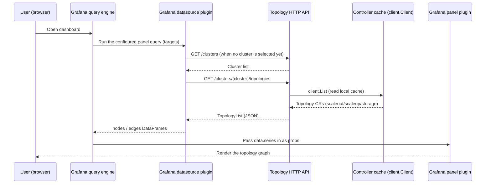

# Topology Visualization Design

中文版本：[topology-visualization.zh.md](./topology-visualization.zh.md)

## Summary

This document describes how the `Topology` CRs of Unifabric (see
[Topology CRD design](./topology-crd.md)) are exposed as an interactive Grafana
dashboard. Three pieces work together: a small read-only HTTP API inside the existing
Controller manager (`pkg/controller/topologyapi`), a Grafana datasource plugin that
queries that API and combines `scaleout`, `scaleup`, and `storage` into one graph
(`plugin/unifabric-unifabrictopology-datasource`), and a Grafana panel plugin that
renders the combined graph with React Flow
(`plugin/unifabric-unifabrictopology-panel`). How to enable and use the dashboard is
in [Topology visualization usage](../usage/topology-visualization.md).

## Motivation

`kubectl get topology scaleout -o yaml` already exposes performance domains, parents,
members, and Node paths as structured status. That is enough for automation and for
`kubectl`-based debugging. It does not answer a question operators keep asking during
onboarding and incident review: what does this fabric look like, and where does a
given Node or switch sit in it.

Three `Topology` objects, each read independently, do not show that either.
`scaleout`, `scaleup`, and `storage` describe independent fabrics, but they all attach
to the same physical Nodes. An operator who compares them by hand must cross-reference
Node names across three separate `status.nodes` lists, instead of looking at one
combined graph in a web interface.

User stories:

- As a platform operator, I want one graph that shows all three fabrics around a
  shared row of hosts, so I can see where a Node or switch sits without
  cross-referencing YAML.
- As a Grafana administrator, I want the topology view as a datasource and panel
  plugin, so it lives next to the existing RDMA dashboards.

### Goals

- Add a read-only HTTP API that exposes every fixed `Topology` object, so an external
  visualization tool can query it without a Kubernetes client or its own RBAC setup.
- Combine `scaleout`, `scaleup`, and `storage` into one graph that shares a single row
  of hosts, instead of drawing each Node once per topology.
- Ship a Grafana datasource and panel plugin pair that renders that graph with a
  tier-aware layout: tier 1 nearest the host row, higher tiers stacked further away,
  matching the tier convention of the CRD.
- Shape the API contract so a multi-cluster product can later serve the same routes
  for several real clusters, without a breaking change to the OSS contract or the
  plugins.

### Non-Goals

- Authentication and authorization for the API. The API is disabled by default and
  left to a NetworkPolicy or an ingress in front of it.
- Historical or time-series topology views. The API always reflects the current
  cached state of the Controller, not a point in time.
- Editing topology from the dashboard.

## Proposal



The API is not a separate Deployment. `NewTopologyAPIServer` registers a small
`http.Server` with the existing `manager.Manager` of the Controller via `mgr.Add(...)`.
It starts and stops with the Controller and reads through the same cached
`client.Client` that the rest of the Controller uses. Every replica serves reads from
its own cache, so the server reports `NeedLeaderElection() bool { return false }` and
does not wait for the leader lease. No new binary, image, Deployment, Service, or
RBAC rule is needed beyond what the Controller already has (`get`, `list`, and `watch`
on `Topology`, `Switch`, and `FabricNode`). The chart only adds a container port and a
Service port, gated by one configuration flag.

The API is disabled by default (`topologyAPI.enabled: false`) because it has no
authentication of its own. Enabling it is an explicit administrator decision, usually
paired with a NetworkPolicy or an ingress rule that restricts access to the Grafana
instance.

`plugin/` also contains a mock API server (`plugin/mock-topology-api`) and a local
Grafana development environment (`plugin/docker-compose.yaml`,
`make grafana-plugin-dev`). Developers build and test the plugins with them, without a
real cluster.

## Detailed Design

### API routes

| Route | Response | Notes |
| --- | --- | --- |
| `GET /healthz` | `200 OK` | Liveness check, no body. |
| `GET /clusters` | `[ {"name":"..."} ]` | Clusters this API can serve resources for. |
| `GET /clusters/{cluster}/topologies` | `v1beta1.TopologyList` | `404` when `{cluster}` is not recognized. |
| `GET /clusters/{cluster}/topologies/{name}` | `v1beta1.Topology` | `404` when the cluster or topology is not found. |
| `GET /clusters/{cluster}/switches` | `v1beta1.SwitchList` | `404` when `{cluster}` is not recognized. |
| `GET /clusters/{cluster}/switches/{name}` | `v1beta1.Switch` | `404` when the cluster or switch is not found. |
| `GET /clusters/{cluster}/fabricnodes` | `v1beta1.FabricNodeList` | `404` when `{cluster}` is not recognized. |
| `GET /clusters/{cluster}/fabricnodes/{name}` | `v1beta1.FabricNode` | `404` when the cluster or FabricNode is not found. |

Each resource list handler returns what `client.List` and standard Kubernetes JSON
encoding produce for its list type. No separate DTO layer sits between the CRDs and
the HTTP responses, so each resource shape follows its CRD directly. See
[Topology CRD design](./topology-crd.md) for the topology field semantics.

### Multi-cluster route shape

All resource routes are cluster-first: `/clusters/{cluster}/{resource}[/{name}]`. A
separate `/clusters` route also exists, even though the open-source Controller only
manages the cluster it runs in. This shape lets a Unifabric variant that aggregates
several real clusters serve the same resource routes for more than one cluster.

In the OSS build, `defaultClusterName = "default"` is the only accepted value.
`GET /clusters` always returns a single `{"name": "default"}` entry, and every
`/clusters/{cluster}/...` route returns `404` for any other cluster name. The plugins
do not know which build they talk to. They call `/clusters` first, or let the
`$cluster` template variable of the dashboard provide the value, and the datasource
then calls `/clusters/{cluster}/topologies` for the selected cluster, defaulting to
the first entry that `/clusters` returns.

### Grafana datasource plugin

`unifabric-unifabrictopology-datasource` is a plain HTTP-backed Grafana datasource:

- `ConfigEditor` collects one field, the API base URL, as a plain `Input`. There is no
  authentication field because the backend has none. `testDatasource()` calls
  `GET /clusters` as a connectivity test.
- `QueryEditor` shows a "Cluster" select populated by `GET /clusters`, defaulting to
  the first cluster returned when a query has none set.
- `metricFindQuery()` powers a dashboard-level `$cluster` template variable. A
  dashboard offers one cluster dropdown, and the query of every panel reads it through
  `getTemplateSrv().replace(...)`, instead of configuring the cluster per panel.
- `query()` fetches `GET /clusters/{cluster}/topologies` and flattens the
  `status.domains` and `status.nodes` of every item into two combined DataFrames,
  `nodes` and `edges`:
  - Domain IDs are namespaced by topology (`<topology>/<domain>`), because domain
    names are only unique within one `Topology` CR, not across `scaleout`, `scaleup`,
    and `storage`.
  - Host IDs are not namespaced. The same physical Node can appear in the
    `status.nodes` of more than one topology, and it renders as a single shared host
    with one edge per topology domain that references it, instead of one copy per
    topology.

### Grafana panel plugin

`unifabric-unifabrictopology-panel` renders the combined `nodes` and `edges` frames
with `reactflow`:

- Two node types exist: `domain` (a switch group, showing its topology, tier, title,
  and member switches) and `host` (a GPU or compute Node).
- The layout is four vertically stacked bands, top to bottom: `scaleout`, `scaleup`, a
  shared `hosts` row, then `storage`. `scaleout` and `scaleup` sit above the host row
  and `storage` sits below it, matching how `scaleout`/`scaleup` and `storage` attach
  to the same Nodes from opposite sides.
- Within `scaleout`, `scaleup`, and `storage`, domains stack one row per distinct
  tier, tier 1 always nearest the host row and higher tiers further away, matching the
  tier convention of the CRD (tier 1 nearest a Node, see
  [Topology CRD design](./topology-crd.md)). The height of each band is driven by its
  own content, the tier count and the member list of each domain card, not by a fixed
  fraction of the panel. A deeper fabric gets proportionally more space.
- Edges use the straight line type of `reactflow` and are colored to stay visible in
  both the light and dark Grafana themes. Selecting a node highlights only the edges
  that touch it, and every other edge keeps its normal, not dimmed, color.
- Node positions are owned by the `useNodesState` hook of `reactflow`, so dragging a
  card does not fight with re-renders when the underlying data refreshes.

### Helm values

`topologyAPI.enabled` enables the API. `controller.ports.topologyAPI` is the single
port setting used for the Controller listener, the container port, the Service port,
and the Grafana datasource URL:

```yaml
topologyAPI:
  enabled: false
controller:
  ports:
    topologyAPI: 8082
```

## Risks and Mitigations

- The API has no authentication, and anyone who reaches the port can read topology
  and inventory data. Mitigation: the API is disabled by default, and enabling it is
  an explicit decision paired with a NetworkPolicy or an ingress rule.
- Reads come from per-replica caches, so a reply can lag the API server briefly.
  Accepted: the dashboard is a viewing tool, and the cache converges through the
  normal watch stream.

## Alternatives

The alternatives below are reconstructed from the decisions this design argues
against. They were not recorded at decision time.

- A separate API Deployment. Rejected because the Controller already caches all three
  resource types. A second Deployment needs its own image, Service, RBAC, and
  cache, for the same data. `mgr.Add(...)` reuses all of it.
- A DTO layer between the CRDs and the HTTP responses. Rejected because the plugins
  consume the CRD shapes directly and the CRD is already the public contract. A DTO
  adds a second contract to version.
- Built-in authentication in the API. Deferred, not built. The expected deployment
  pairs the API with the in-cluster Grafana, and a NetworkPolicy or an ingress covers
  that. Disabled-by-default keeps the decision with the administrator.
- Flat routes without the `/clusters/{cluster}` prefix. Rejected because a
  multi-cluster variant then needs new routes and new plugin logic. The
  cluster-first shape costs one constant (`default`) in the OSS build.
- One graph per topology, three panels. Rejected because the fabrics share the same
  physical Nodes, and the shared host row is the point of the visualization.

## Implementation History

- 2026-08-24: Grafana topology visualization implemented: Topology HTTP API,
  datasource plugin, and panel plugin.
- 2026-10-13: Document restructured into the design template. The Alternatives
  section is a post-hoc reconstruction.
