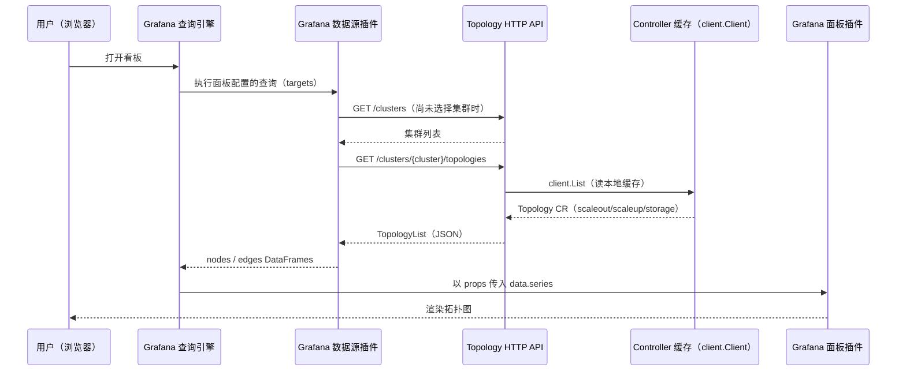

# 拓扑可视化设计

English version: [topology-visualization.md](./topology-visualization.md)

## 概要

本文描述 Unifabric 的 `Topology` CR（见 [Topology CRD 设计](./topology-crd.md)）如何以
交互式 Grafana 看板的形式呈现。三个部分协同工作：运行在现有 Controller manager 内的小型
只读 HTTP API（`pkg/controller/topologyapi`）、查询该 API 并把 `scaleout`、`scaleup`、
`storage` 合并为一张图的 Grafana 数据源插件
（`plugin/unifabric-unifabrictopology-datasource`），以及用 React Flow 渲染合并图的
Grafana 面板插件（`plugin/unifabric-unifabrictopology-panel`）。如何启用和使用看板见
[拓扑可视化使用指南](../usage/topology-visualization.md)。

## 动机

`kubectl get topology scaleout -o yaml` 已经以结构化 status 暴露性能域、父子关系、成员和
Node 路径。这对自动化和基于 `kubectl` 的排障够用，但回答不了运维人员在交付和故障复盘时
反复问的问题：这张网络到底长什么样，某个 Node 或交换机在其中处于什么位置。

三个 `Topology` 对象各自单独读取也展示不了这一点。`scaleout`、`scaleup` 和 `storage` 描述
相互独立的网络，但它们都连接到同一批物理 Node。手工对比的运维人员必须在三份独立的
`status.nodes` 列表里交叉核对 Node 名，而不是在网页界面里直接看一张合并的图。

用户故事：

- 作为平台运维人员，我想要一张围绕共享主机行展示三张网络的图，不用交叉核对 YAML 就能看到
  某个 Node 或交换机的位置。
- 作为 Grafana 管理员，我希望拓扑视图以数据源加面板插件的形式提供，和现有的 RDMA 看板放在
  一起。

### 目标

- 增加一个只读 HTTP API，暴露所有固定 `Topology` 对象，让外部可视化工具无需 Kubernetes
  客户端或自己的 RBAC 配置即可查询。
- 把 `scaleout`、`scaleup` 和 `storage` 合并为一张共享单行主机的图，而不是每个拓扑画一遍
  Node。
- 提供一对 Grafana 数据源和面板插件，以层级感知的布局渲染这张图：tier 1 最靠近主机行，
  更高层级向外堆叠，与 CRD 自身的层级约定一致。
- 把 API 契约设计成多集群产品日后可以为多个真实集群提供相同路由的形状，不对 OSS 契约和
  插件造成破坏性变更。

### 非目标

- API 的认证和鉴权。API 默认关闭，交给前置的 NetworkPolicy 或 ingress。
- 历史或时间序列拓扑视图。API 始终反映 Controller 当前的缓存状态，不是某个时间点。
- 在看板上编辑拓扑。

## 方案



API 不是独立的 Deployment。`NewTopologyAPIServer` 通过 `mgr.Add(...)` 把一个小型
`http.Server` 注册到 Controller 现有的 `manager.Manager` 上。它随 Controller 启停，并通过
Controller 其余部分使用的同一个带缓存的 `client.Client` 读取数据。每个副本都从自己的缓存
提供读服务，因此 server 返回 `NeedLeaderElection() bool { return false }`，不等待也不需要
leader 租约。除 Controller 已有的权限（对 `Topology`、`Switch`、`FabricNode` 的 `get`、
`list`、`watch`）之外，不需要新的二进制、镜像、Deployment、Service 或 RBAC 规则。chart 只
增加一个容器端口和一个 Service 端口，由一个配置开关控制。

API 默认关闭（`topologyAPI.enabled: false`），因为它自身没有认证。启用它是管理员的显式
决定，通常配合限制 Grafana 实例访问的 NetworkPolicy 或 ingress 规则。

`plugin/` 还包含一个 mock API server（`plugin/mock-topology-api`）和本地 Grafana 开发环境
（`plugin/docker-compose.yaml`、`make grafana-plugin-dev`）。开发者用它们在没有真实集群的
情况下构建和测试插件。

## 详细设计

### API 路由

| 路由 | 响应 | 说明 |
| --- | --- | --- |
| `GET /healthz` | `200 OK` | 存活检查，无 body。 |
| `GET /clusters` | `[ {"name":"..."} ]` | 该 API 可提供资源的集群列表。 |
| `GET /clusters/{cluster}/topologies` | `v1beta1.TopologyList` | `{cluster}` 不识别时返回 `404`。 |
| `GET /clusters/{cluster}/topologies/{name}` | `v1beta1.Topology` | 集群或拓扑不存在时返回 `404`。 |
| `GET /clusters/{cluster}/switches` | `v1beta1.SwitchList` | `{cluster}` 不识别时返回 `404`。 |
| `GET /clusters/{cluster}/switches/{name}` | `v1beta1.Switch` | 集群或交换机不存在时返回 `404`。 |
| `GET /clusters/{cluster}/fabricnodes` | `v1beta1.FabricNodeList` | `{cluster}` 不识别时返回 `404`。 |
| `GET /clusters/{cluster}/fabricnodes/{name}` | `v1beta1.FabricNode` | 集群或 FabricNode 不存在时返回 `404`。 |

每个资源列表 handler 返回 `client.List` 和标准 Kubernetes JSON 编码对对应列表类型产出的
内容。CRD 和 HTTP 响应之间没有独立的 DTO 层，每个资源的形状直接遵循其 CRD。拓扑字段语义见
[Topology CRD 设计](./topology-crd.md)。

### 多集群路由形状

所有资源路由都是集群前置的：`/clusters/{cluster}/{resource}[/{name}]`。另有独立的
`/clusters` 路由，尽管开源版 Controller 只管理它所在的集群。这个形状让聚合多个真实集群的
Unifabric 变体可以为多个集群提供相同的资源路由。

在 OSS 构建中，`defaultClusterName = "default"` 是唯一接受的值。`GET /clusters` 始终返回
单个 `{"name": "default"}` 条目，其他集群名下的所有 `/clusters/{cluster}/...` 路由返回
`404`。插件不感知自己对接的是哪种构建。插件先调用 `/clusters`，或由看板的 `$cluster` 模板
变量提供取值，数据源再为所选集群调用 `/clusters/{cluster}/topologies`，默认取 `/clusters`
返回的第一个条目。

### Grafana 数据源插件

`unifabric-unifabrictopology-datasource` 是普通的 HTTP Grafana 数据源：

- `ConfigEditor` 只收集一个字段，即 API 基础 URL，使用普通 `Input`。后端没有认证，所以没有
  认证字段。`testDatasource()` 调用 `GET /clusters` 做连通性测试。
- `QueryEditor` 显示一个由 `GET /clusters` 填充的 "Cluster" 下拉框，查询未设置时默认取
  返回的第一个集群。
- `metricFindQuery()` 支撑看板级 `$cluster` 模板变量。看板提供一个集群下拉框，每个面板的
  查询通过 `getTemplateSrv().replace(...)` 读取它，而不是逐面板配置集群。
- `query()` 拉取 `GET /clusters/{cluster}/topologies`，把每个条目的 `status.domains` 和
  `status.nodes` 拍平为两个合并的 DataFrame：`nodes` 和 `edges`：
  - 性能域 ID 按拓扑加命名空间（`<topology>/<domain>`），因为域名只在单个 `Topology` CR
    内唯一，在 `scaleout`、`scaleup`、`storage` 之间不唯一。
  - 主机 ID 不加命名空间。同一台物理 Node 可以出现在多个拓扑的 `status.nodes` 中，渲染为
    单个共享主机，每个引用它的拓扑性能域画一条边，而不是每个拓扑画一份副本。

### Grafana 面板插件

`unifabric-unifabrictopology-panel` 用 `reactflow` 渲染合并后的 `nodes` 和 `edges`：

- 两种节点类型：`domain`（交换机分组，展示其拓扑、层级、标题和成员交换机）和 `host`
  （GPU 或计算 Node）。
- 布局为自上而下四个纵向堆叠的条带：`scaleout`、`scaleup`、共享的 `hosts` 行、`storage`。
  `scaleout` 和 `scaleup` 在主机行上方，`storage` 在下方，对应 `scaleout`/`scaleup` 和
  `storage` 从两侧连接同一批 Node 的方式。
- 在 `scaleout`、`scaleup` 和 `storage` 内部，性能域按层级逐行堆叠，tier 1 始终最靠近主机
  行，更高层级向外，与 CRD 自身的层级约定一致（tier 1 最靠近 Node，见
  [Topology CRD 设计](./topology-crd.md)）。每个条带的高度由自身内容决定，即层级数和每张
  域卡片的成员列表，不是面板的固定比例。更深的网络获得成比例更多的空间。
- 边使用 `reactflow` 的直线类型，配色在 Grafana 明暗两种主题下都可见。选中一个节点只高亮
  与它相连的边，其余边保持正常颜色，不变暗。
- 节点位置由 `reactflow` 自己的 `useNodesState` 管理，拖动卡片不会与底层数据刷新引发的
  重渲染冲突。

### Helm values

`topologyAPI.enabled` 启用 API。`controller.ports.topologyAPI` 是唯一的端口设置，同时用于
Controller 监听器、容器端口、Service 端口和 Grafana 数据源 URL：

```yaml
topologyAPI:
  enabled: false
controller:
  ports:
    topologyAPI: 8082
```

## 风险与缓解

- API 没有认证，能访问端口的人都能读取拓扑和清单数据。缓解：API 默认关闭，启用是显式决定，
  并配合 NetworkPolicy 或 ingress 规则。
- 读来自各副本缓存，响应可能短暂落后于 API server。接受：看板是查看工具，缓存通过正常的
  watch 流收敛。

## 备选方案

以下备选方案根据本设计所反对的决策事后重建，并非决策时的记录。

- 独立的 API Deployment。否决，因为 Controller 已经缓存了全部三种资源类型。第二个
  Deployment 需要自己的镜像、Service、RBAC 和缓存，数据却相同。`mgr.Add(...)` 复用这一切。
- 在 CRD 和 HTTP 响应之间加 DTO 层。否决，因为插件直接消费 CRD 形状，CRD 已经是公开契约。
  DTO 会增加第二份需要维护版本的契约。
- 在 API 内置认证。推迟，未实现。预期部署把 API 和集群内 Grafana 配对，NetworkPolicy 或
  ingress 已覆盖该场景。默认关闭把决定权留给管理员。
- 不带 `/clusters/{cluster}` 前缀的扁平路由。否决，因为多集群变体将需要新路由和新插件逻辑。
  集群前置的形状在 OSS 构建中只花费一个常量（`default`）。
- 每个拓扑一张图、三个面板。否决，因为三张网络共享同一批物理 Node，共享主机行正是这个
  可视化的意义所在。

## 实现历史

- 2026-08-24：Grafana 拓扑可视化实现：Topology HTTP API、数据源插件和面板插件。
- 2026-10-13：文档按设计模板重构。备选方案一节为事后重建。
