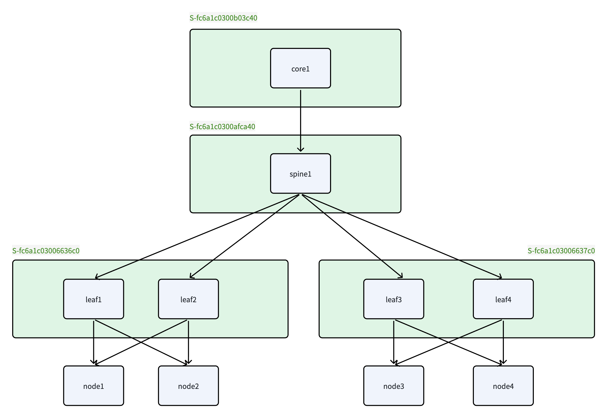

# Deploy Unifabric on an InfiniBand Fabric

中文版: [getting-started-infiniband.zh.md](./getting-started-infiniband.zh.md)

## Introduction and Deployment Goals

This guide deploys Unifabric topology discovery in a cluster with an InfiniBand
network, for example Mellanox NICs in IB mode with IB switches. In this
environment, NVIDIA Topograph discovers the fabric topology, and Unifabric
writes the result to Node labels.

The diagram below shows the example topology for this guide: a three-tier
fabric with tier 3 core, tier 2 spine, and tier 1 leaf switches. The four Nodes
belong to two tier 1 performance domains:



After scale-out topology discovery completes, the four Nodes carry these
labels:

| Node | Expected labels |
| --- | --- |
| `node1` | `scale-out.unifabric.io/tier-1=S-fc6a1c03006636c0`<br>`scale-out.unifabric.io/tier-2=S-fc6a1c0300afca40`<br>`scale-out.unifabric.io/tier-3=S-fc6a1c0300b03c40` |
| `node2` | `scale-out.unifabric.io/tier-1=S-fc6a1c03006636c0`<br>`scale-out.unifabric.io/tier-2=S-fc6a1c0300afca40`<br>`scale-out.unifabric.io/tier-3=S-fc6a1c0300b03c40` |
| `node3` | `scale-out.unifabric.io/tier-1=S-fc6a1c03006637c0`<br>`scale-out.unifabric.io/tier-2=S-fc6a1c0300afca40`<br>`scale-out.unifabric.io/tier-3=S-fc6a1c0300b03c40` |
| `node4` | `scale-out.unifabric.io/tier-1=S-fc6a1c03006637c0`<br>`scale-out.unifabric.io/tier-2=S-fc6a1c0300afca40`<br>`scale-out.unifabric.io/tier-3=S-fc6a1c0300b03c40` |

A larger tier number is a position closer to the upper layers of the network.
Scale-up labels come from the GPU interconnect topology inside each Node. The
diagram does not show them.

After the deployment, Agent metrics and the built-in RDMA Grafana dashboard
show Node RDMA state: throughput, utilization, QoS, congestion, and error
metrics by cluster, Node, Pod, and Workload.

## Prerequisites

Make sure that each item below is true before you continue:

- [ ] Unifabric is installed through the [basic installation](./getting-started.md).
- [ ] The Nodes have RDMA devices in IB mode.

## Installation

First complete the [basic installation](./getting-started.md). It deploys the
Controller, the Agent, and the observability components that every scenario
shares. This guide adds no other installation step.

## Environment Configuration

Select NVIDIA Topograph as the writer for the InfiniBand scale-up and scale-out
networks. The command changes only the scenario-specific modes and keeps every
other value from the basic installation. Run it on a host with `kubectl` and
Helm access to the cluster:

```bash
helm upgrade unifabric oci://ghcr.io/unifabric-io/charts/unifabric \
  --namespace unifabric-system \
  --reuse-values \
  --set topoDiscovery.scaleUp.mode=nv-topograph \
  --set topoDiscovery.scaleOut.mode=nv-topograph \
  --wait
```

```text
<!-- TODO: capture output from a real environment -->
```

## Verification

Inspect the topograph components, the node-data-broker DaemonSet, and the Node
labels:

```bash
kubectl -n unifabric-system get pods
kubectl get pods -n unifabric-system -o wide
kubectl get fabricnodes.unifabric.io
kubectl get nodes -L scale-up.unifabric.io/tier-1,scale-out.unifabric.io/tier-1,scale-out.unifabric.io/tier-2,scale-out.unifabric.io/tier-3,kubernetes.io/hostname
```

The `FabricNode` list contains every target Node with `READY` set to `True`:

```text
NAME                TOTALNICS   READY   ROLE   NODEIP
node1               2           True    GPU    10.0.0.1
node2               2           True    GPU    10.0.0.2
node3               2           True    GPU    10.0.0.3
node4               2           True    GPU    10.0.0.4
```

Inspect the Agent report for one Node. The short name `fn` also selects
`FabricNode` resources:

```bash
kubectl get fabricnode <node-name> -o yaml
```

```text
<!-- TODO: capture output from a real environment -->
```

Make sure that `status.nodeRole`, `status.scaleOutNics`, and
`status.conditions` match the expected state and that the participating IB NICs
are `up`.

After scale-out topology discovery succeeds, the Controller creates the
`scaleout` Topology:

```bash
kubectl get topo
```

```text
NAME       AGE
scaleout   113m
```

Inspect the complete result. `status.domains` describes the parent-child
relationships between performance domains. `status.nodes[].switchDomainPath`
records the complete path of each Node from tier 3 down to tier 1:

```bash
kubectl get topo scaleout -o yaml
```

```text
<!-- TODO: capture output from a real environment -->
```

When you configure Kueue, Volcano, or KAI Scheduler, use only labels that are
written to Nodes.

## Troubleshooting

First rule out the general `FabricNode` and RDMA metrics problems with the
[basic installation troubleshooting](./getting-started.md#troubleshooting).

### Node Labels Are Not Written

1. Make sure that NVIDIA topograph, node-observer, and node-data-broker are
   running and have permission to update Nodes.
2. Make sure that node-data-broker Pods run on the target GPU nodes.
3. If scale-out labels are not written, make sure that `ibnetdiscover` is
   available in the node-data-broker Pod.
4. If `topoDiscovery.*.nodeLabel.keyTemplate` values are customized, update the
   scheduler label keys to match.

## Uninstall

Remove the Helm release:

```bash
helm uninstall unifabric --namespace unifabric-system --wait
```

```text
<!-- TODO: capture output from a real environment -->
```

If you no longer need the CRDs, delete them. This also deletes all `FabricNode`,
`Switch`, and `Topology` resources:

```bash
kubectl delete crd fabricnodes.unifabric.io switches.unifabric.io topologies.unifabric.io
```

```text
<!-- TODO: capture output from a real environment -->
```

## Next Steps

- Use the labels in a scheduler with the [Kueue TAS workload example](./usage/workload-tas.md).
- Render the topology with the [topology visualization guide](./usage/topology-visualization.md).
- Look up fields in the [FabricNode reference](./reference/fabricnode.md).
- Tune the installation with the [Helm values reference](../chart/README.md).
