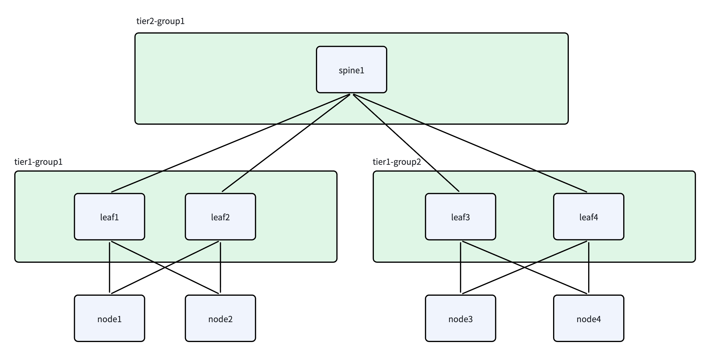

# Deploy Unifabric on a General SONiC RoCE Fabric

中文版: [getting-started-sonic-roce.zh.md](./getting-started-sonic-roce.zh.md)

## Introduction and Deployment Goals

This guide deploys Unifabric topology discovery in a cluster where SONiC switches
carry the RoCE network. RoCE is RDMA over a converged Ethernet fabric. Unifabric
discovers the leaf, spine, and core topology from node RDMA NICs, from `FabricNode`
LLDP neighbors, and optionally from switch-side LLDP snapshots. LLDP is a protocol in
which each device announces itself to its link peers.

After you finish this guide, the cluster will show the following results:

- Nodes carry tiered topology labels such as `scale-out.unifabric.io/tier-1`, the tier
  nearest to a Node, followed by `tier-2`, `tier-3`, and so on. Built-in discovery uses
  `tierN-groupM` label values, for example `scale-out.unifabric.io/tier-1=tier1-group1`.
- `FabricNode` and `Switch` resources expose the discovery input, and `Topology`
  resources expose the aggregated read-only topology.
- Node RDMA state is observable through Agent metrics.

This guide covers two cases. Select one before you start:

| Case | Use it when | What you need |
| --- | --- | --- |
| Case 1: node LLDP only | Security policies prohibit software on the switches, or another team manages the switches | Nodes discover their leaf switches through node-side LLDP. An administrator declares tiers above the leaf layer with `Switch` resources and neighbor annotations. |
| Case 2: switches run `switch-agent` (recommended) | The operations team can run the Unifabric Switch Agent on SONiC switches, and you want automatic switch-to-switch discovery | LLDP is enabled on the switches. The Kubernetes Node that runs `unifabric-controller` can reach TCP port `8090` on each switch. |

## Prerequisites

Make sure that each item below is true before you continue:

- [ ] Unifabric is installed through the [basic installation](./getting-started.md).
- [ ] SONiC switches carry the RoCE network, and LLDP is enabled on every switch.
- [ ] Nodes have RDMA NICs, and the devices are visible under `/sys/class/infiniband`.
- [ ] For Case 2 only: each switch runs Docker or another container runtime. If a
      switch cannot run containers, use the
      [switch-agent systemd installation](./usage/switch-agent-deployment.md).
- [ ] For Case 2 only: the Node that runs `unifabric-controller` can reach TCP port
      `8090` on the management IP of each switch.

## Installation

First complete the [basic installation](./getting-started.md). It deploys the
Controller, the Agent, and the observability components that every scenario shares.

The basic installation defaults already select `unifabric-roce` as the scale-out
topology writer. No additional change is normally required. To apply the scenario
setting explicitly, run this command. Use a host with `kubectl` and Helm access to
the cluster:

```bash
helm upgrade unifabric oci://ghcr.io/unifabric-io/charts/unifabric \
  --namespace unifabric-system \
  --reuse-values \
  --set topoDiscovery.scaleOut.mode=unifabric-roce \
  --wait
```

```text
<!-- TODO: capture output from a real environment -->
```

If the RoCE fabric also carries the storage network, add this option to the command
above:

```bash
--set topoDiscovery.storage.mode=unifabric-roce
```

These settings select only the topology writers for the SONiC RoCE scenario. Image and
observability settings remain those from the basic installation.

## Environment Configuration

Both cases below use the same example fabric. `node1` and `node2` connect through
`leaf1` and `leaf2` and form `tier1-group1`. `node3` and `node4` connect through
`leaf3` and `leaf4` and form `tier1-group2`. Their common uplink `spine1` forms
`tier2-group1`.



### Case 1: Node LLDP Only

In this case, no software runs on the switches. When no same-role `Switch` resources
exist, Unifabric enters node-only mode. It treats the switch hostnames that
`FabricNode` LLDP reports as synthetic leaves and generates only tier 1.

1. Wait for the Agents to report LLDP neighbors. No switch-side action is required for
   tier 1. In the example fabric, discovery generates the two tier 1 domains, and each
   Node receives its `scale-out.unifabric.io/tier-1` label.

2. To describe upper tiers such as spine or core, create one `Switch` resource per
   upper-tier switch and add the `unifabric.io/switch-neighbors` annotation to each.
   Do not create resources for the leaves, and do not set `spec.mgmtIP`. For the
   example fabric, apply this file on a host with `kubectl` access:

   ```yaml
   apiVersion: unifabric.io/v1beta1
   kind: Switch
   metadata:
     name: spine1
     annotations:
       unifabric.io/switch-neighbors: '["leaf1", "leaf2", "leaf3", "leaf4"]'
   spec:
     role: ScaleOut
   ```

   ```bash
   kubectl apply -f spine1.yaml
   ```

   ```text
   <!-- TODO: capture output from a real environment -->
   ```

> **Warning:** Do not put Kubernetes Node names in `unifabric.io/switch-neighbors`.
> The annotation lists switch neighbors only. Node-to-switch links come from
> `FabricNode` LLDP. A Node name in the array corrupts the computed topology.

> **Note:** Mode selection tests only whether the annotation key exists on every
> same-role `Switch`. An empty value or `[]` selects this mode but supplies no
> neighbor link.

After the apply, all four Nodes receive both tier 1 and tier 2 labels. The
[Verification](#verification) section shows the expected `Topology` content.

### Case 2: Automatic Discovery with switch-agent

In this case, `switch-agent` runs on every participating switch and reports LLDP
snapshots to the Controller over mutually authenticated TLS (mTLS). If any same-role
`Switch` resource omits the `unifabric.io/switch-neighbors` key, Unifabric enters
fully automatic mode and ignores all such annotations. To keep the configuration
unambiguous, omit the annotation from every `Switch`.

> **Note:** To deploy to many switches at once, use the
> [automated switch-agent deployment script](./usage/switch-agent-deployment.md)
> instead of the manual steps below.

1. Export the pinned mTLS certificates. Run these commands on a host with `kubectl`
   access to the cluster:

   ```bash
   mkdir -p ./tmp-switch-mtls

   kubectl -n unifabric-system get secret switch-controller-mtls-agent -o jsonpath='{.data.tls\.crt}' | base64 -d > ./tmp-switch-mtls/tls.crt
   kubectl -n unifabric-system get secret switch-controller-mtls-agent -o jsonpath='{.data.tls\.key}' | base64 -d > ./tmp-switch-mtls/tls.key
   kubectl -n unifabric-system get secret switch-controller-mtls-agent -o jsonpath='{.data.peer\.crt}' | base64 -d > ./tmp-switch-mtls/peer.crt
   ```

   ```text
   <!-- TODO: capture output from a real environment -->
   ```

2. Log in to the target switch and create the certificate directory:

   ```bash
   sudo mkdir -p /opt/unifabric-switch-agent/mtls
   ```

   ```text
   <!-- TODO: capture output from a real environment -->
   ```

   Then copy `tls.crt`, `tls.key`, and `peer.crt` into
   `/opt/unifabric-switch-agent/mtls/` on the switch.

3. On the switch, make sure that LLDP sees the expected neighbors:

   ```bash
   lldpcli show neighbors -f json0
   ```

   ```text
   <!-- TODO: capture output from a real environment -->
   ```

4. Start `switch-agent` on the switch. The command below uses Docker bridge networking
   and publishes the gRPC port through `-p 8090:8090`. It reads LLDP through the
   mounted `lldpd` socket and does not require host network or privileged permissions.

   ```bash
   export SWITCH_AGENT_IMAGE="ghcr.io/unifabric-io/unifabric-switch-agent:<release-tag>"
   export SWITCH_NAME="$(hostname)"

   docker pull "${SWITCH_AGENT_IMAGE}"

   docker rm -f unifabric-switch-agent 2>/dev/null || true

   docker run -d \
     --name unifabric-switch-agent \
     --restart unless-stopped \
     -p 8090:8090 \
     -e UNIFABRIC_SWITCH_AGENT_SWITCH_NAME="${SWITCH_NAME}" \
     -v /run/lldpd.socket:/run/lldpd.socket \
     -v /opt/unifabric-switch-agent/mtls:/etc/unifabric/switch-mtls:ro \
     "${SWITCH_AGENT_IMAGE}" \
     /usr/bin/unifabric/switch-agent
   ```

   ```text
   <!-- TODO: capture output from a real environment -->
   ```

   > **Note:** If the switch runs SONiC 202006 through 202311, add
   > `-e UNIFABRIC_SWITCH_AGENT_LLDP_CLI_VERSION=1.0.4`. Keep the default `1.0.16`
   > for other versions.

   > **Note:** If the switch cannot mount `/run/lldpd.socket`, use the
   > [hostProc collection mode](./usage/switch-agent-deployment.md) instead. That
   > mode requires privileged permissions and mounts the host `/proc`. For all other
   > environment variables, see the
   > [switch-agent reference](./usage/switch-agent-deployment.md).

5. Make sure that the container is running and that the logs contain no errors:

   ```bash
   docker ps | grep unifabric-switch-agent
   docker logs --tail 100 unifabric-switch-agent
   ```

   ```text
   <!-- TODO: capture output from a real environment -->
   ```

6. Create one `Switch` resource per switch. The Controller connects to `spec.mgmtIP`
   to read LLDP snapshots. For the example fabric, create five resources: `leaf1`
   through `leaf4` and `spine1`. Each resource looks like this:

   ```yaml
   apiVersion: unifabric.io/v1beta1
   kind: Switch
   metadata:
     name: leaf1
   spec:
     mgmtIP: 192.0.2.11
     role: ScaleOut
     grpcPort: 8090
   ```

   Set `role` to the network that the switch serves. `ScaleOut` means that the switch
   connects host RDMA NICs used for cross-node traffic. `Storage` means that the switch
   connects the NICs that `fabricNode.storageInterfaceSelector` selects. `ScaleUp`
   means that the switch connects GPU-side interconnect NICs. The default is
   `ScaleOut`. `grpcPort` defaults to `8090`.

   On a host with `kubectl` access, apply the files:

   ```bash
   kubectl apply -f leaf1.yaml
   ```

   ```text
   <!-- TODO: capture output from a real environment -->
   ```

## Verification

Make sure that the Controller and the Agent are ready:

```bash
kubectl -n unifabric-system rollout status deployment/unifabric-controller
kubectl -n unifabric-system rollout status daemonset/unifabric-agent
```

```text
<!-- TODO: capture output from a real environment -->
```

Inspect a `FabricNode`:

```bash
kubectl get fabricnode <node-name> -o yaml
```

```text
<!-- TODO: capture output from a real environment -->
```

Make sure that the output satisfies all of the following:

- `status.scaleOutNics` contains the expected scale-out RDMA NICs.
- `status.scaleOutNics[*].lldpNeighbor.hostname` is present.
- `Ready` and `LLDPNeighborsReady` in `status.conditions` are `True`.

For Case 2, inspect the `Switch` resources:

```bash
kubectl get switch
```

```text
NAME     MGMTIP            ROLE       HEALTHY   NEIGHBORS
leaf1    192.168.122.72    ScaleOut   true      2
leaf2    192.168.122.80    ScaleOut   true      2
spine1   192.168.122.163   ScaleOut   true      2
```

Make sure that `HEALTHY` is `true` and `NEIGHBORS` is greater than `0` for every
switch.

Inspect the Node labels:

```bash
kubectl get nodes -L scale-out.unifabric.io/tier-1,scale-out.unifabric.io/tier-2,kubernetes.io/hostname
```

```text
<!-- TODO: capture output from a real environment -->
```

Make sure that each Node has a contiguous sequence of
`scale-out.unifabric.io/tier-N` labels, with tier 1 nearest to the Node. In Case 1
without upper-tier `Switch` resources, tier 1 alone is the expected result.

Inspect the aggregated topology. The Controller creates the `Topology` resource only
after discovery produces a valid result:

```bash
kubectl get topology scaleout -o yaml
```

For Case 2 with the example fabric, the status contains both tiers, and
`switchMember` lists the real `Switch` names:

```text
<!-- TODO: capture output from a real environment -->
```

For Case 1 in node-only mode, only tier 1 domains appear, and `switchMember` is
empty, because synthetic leaves have no `Switch` resources.

## Troubleshooting

### `FabricNode` Has No Scale-Out NIC

First make sure that the preconditions hold:

1. Make sure that RDMA devices are visible under `/sys/class/infiniband` on the node.
2. If `fabricNode.scaleOutInterfaceSelector` is set, make sure that it matches the
   real interface names or CIDRs.
3. Make sure that the storage or scale-up selector did not match the scale-out
   interfaces. A matched interface leaves the scale-out group.

### `LLDPNeighborsReady` Is `False`

1. Make sure that LLDP is enabled on the switches.
2. Make sure that node-side `lldpd` works and that the Agent Pod can read LLDP data.
3. Make sure that `fabricNode.initialScanDelay` is long enough. A first scan that runs
   before LLDP learning completes reports missing neighbors.

### Nodes Have No Topology Label

1. Make sure that `topoDiscovery.scaleOut.mode=unifabric-roce`.
2. Make sure that `FabricNode.status.nodeRole` is not `Storage`.
3. Make sure that at least one `scaleOutNics` entry has both `state=up` and
   `lldpNeighbor.hostname`.
4. In Case 2, make sure that each LLDP hostname matches a `Switch` name and that the
   switch statuses contain LLDP neighbors.
5. In Case 1 with upper tiers, make sure that every same-role `Switch` carries the
   annotation key and that its neighbor names resolve to node-discovered leaves or to
   other annotated `Switch` resources.
6. Read the Controller logs:

   ```bash
   kubectl -n unifabric-system logs deployment/unifabric-controller
   ```

   ```text
   <!-- TODO: capture output from a real environment -->
   ```

7. In Case 2, read the switch-agent logs on the switch:

   ```bash
   docker logs --tail 100 unifabric-switch-agent
   ```

   ```text
   <!-- TODO: capture output from a real environment -->
   ```

## Uninstall

Remove the Helm release:

```bash
helm uninstall unifabric --namespace unifabric-system --wait
```

```text
<!-- TODO: capture output from a real environment -->
```

If you no longer need the CRDs, delete them. This also deletes all `FabricNode`,
`Switch`, and `Topology` resources:

```bash
kubectl delete crd fabricnodes.unifabric.io switches.unifabric.io topologies.unifabric.io
```

```text
<!-- TODO: capture output from a real environment -->
```

For Case 2, remove the agent container on each switch:

```bash
docker rm -f unifabric-switch-agent
```

```text
<!-- TODO: capture output from a real environment -->
```

## Next Steps

- Use the labels in a scheduler with the [Kueue TAS workload example](./usage/workload-tas.md).
- Render the topology with the [topology visualization guide](./usage/topology-visualization.md).
- Look up fields in the [FabricNode reference](./reference/fabricnode.md).
- Tune the installation with the [Helm values reference](../chart/README.md).
