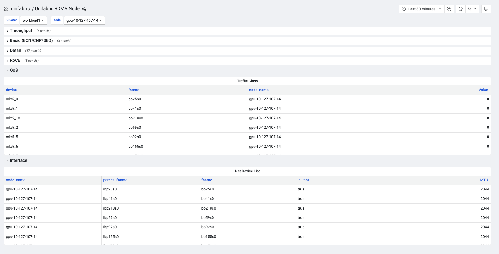

# Basic Installation

中文版: [getting-started.zh.md](./getting-started.zh.md)

## Introduction and Deployment Goals

This guide installs the Unifabric base components with Helm: the Controller, the
Agent, and the observability components. Every environment guide builds on this
installation.

After you finish this guide, the cluster will show the following results:

- A `FabricNode` resource exists for every node and lists its RDMA NICs by
  purpose: scale-out, storage, or scale-up.
- Node RDMA metrics are visible in the `Unifabric RDMA Node` Grafana dashboard.

Topology discovery is environment-specific. After this guide, continue with the
guide for your physical network in [Next Steps](#next-steps).

## Prerequisites

Make sure that each item below is true before you continue:

- [ ] You have access to the target Kubernetes cluster.
- [ ] `kubectl` and Helm are installed on the host that you use for the
      installation.

## Installation

The command below installs the latest Unifabric release. To select a specific
version, read the [releases](https://github.com/unifabric-io/unifabric/releases)
page. Run it on the host with `kubectl` and Helm access to the cluster:

```bash
LATEST_TAG=$(curl -fsSL https://api.github.com/repos/unifabric-io/unifabric/releases/latest | grep '"tag_name":' | cut -d '"' -f4)
CHART_VERSION="${LATEST_TAG#v}"

helm upgrade --install unifabric oci://ghcr.io/unifabric-io/charts/unifabric \
  --version "${CHART_VERSION}" \
  --namespace unifabric-system \
  --create-namespace \
  --wait
```

```text
<!-- TODO: capture output from a real environment -->
```

By default, Unifabric classifies all RDMA NICs on a node as scale-out. If a node
has RDMA NICs for different purposes, add the matching selector to the
installation command with `--set`.

For example, a node has six RDMA NICs named `eth1` through `eth6`. The NICs
`eth1` through `eth4` carry scale-out traffic, and `eth5` and `eth6` carry
storage traffic. Reference architectures of standard GPU servers, such as
DGX H100/B200 and GB200/GB300 NVL72, commonly provide two dedicated storage
NICs. Add this option to the installation command:

```bash
--set fabricNode.storageInterfaceSelector="interface=eth5\,eth6"
```

Unifabric then classifies `eth5` and `eth6` as storage. The other four RDMA
NICs remain scale-out by the default rule. The selector also supports wildcards
and CIDRs, for example `interface=eth*,!eth9` or `cidr=172.17.0.0/16`. The
[Helm values reference](../chart/README.md) describes the complete selector
syntax.

If the cluster does not have Prometheus Operator or Grafana Operator, add these
options to the installation command:

```bash
--set nodeMetrics.serviceMonitor.enabled=false \
--set grafanaDashboard.enabled=false
```

In mainland China, add these options to accelerate image pulls:

```bash
--set global.registry=m.daocloud.io \
--set controller.image.repository=ghcr.io/unifabric-io/unifabric-controller \
--set agent.image.repository=ghcr.io/unifabric-io/unifabric-agent \
--set nvidiaTopograph.image.repository=ghcr.io/nvidia/topograph
```

## Verification

### 1. Inspect FabricNode NIC Information

Make sure that the Controller and Agent Pods are running and that a `FabricNode`
exists for every node:

```bash
kubectl -n unifabric-system get pods
kubectl get fabricnodes
kubectl get fabricnode <node-name> -o yaml
```

```text
<!-- TODO: capture output from a real environment -->
```

Make sure that `status.totalNics`, `status.scaleOutNics`, and
`status.storageNics` match the real NIC configuration of the node. For the
six-NIC example above, the result looks like this:

```yaml
apiVersion: unifabric.io/v1beta1
kind: FabricNode
metadata:
  name: node1
status:
  totalNics: 6
  scaleOutNics:
    - name: eth1
      rdmaDeviceName: mlx5_0
      rdma: true
      state: up
    - name: eth2
      rdmaDeviceName: mlx5_1
      rdma: true
      state: up
    - name: eth3
      rdmaDeviceName: mlx5_2
      rdma: true
      state: up
    - name: eth4
      rdmaDeviceName: mlx5_3
      rdma: true
      state: up
  storageNics:
    - name: eth5
      rdmaDeviceName: mlx5_4
      rdma: true
      state: up
    - name: eth6
      rdmaDeviceName: mlx5_5
      rdma: true
      state: up
```

### 2. Read Node RDMA Metrics

Open the `Unifabric RDMA Node` dashboard in Grafana and select the cluster and
the node at the top of the page. Expand groups such as `Throughput`, `Basic`,
`RoCE`, `QoS`, or `Interface`. Make sure that the dashboard lists the RDMA
devices, the network interfaces, and the metrics of the node.



If the dashboard shows the devices, the `ifname` values, and the metric data of
the target node, Prometheus collects the Agent metrics correctly.

## Troubleshooting

### FabricNode Does Not Discover the Expected RDMA NICs

First make sure that the preconditions hold:

1. Make sure that the Agent Pods are running:

   ```bash
   kubectl -n unifabric-system get daemonset unifabric-agent
   kubectl -n unifabric-system logs daemonset/unifabric-agent -c agent
   ```

   ```text
   <!-- TODO: capture output from a real environment -->
   ```

2. Make sure that the RDMA devices of the node are visible to the Agent:

   ```bash
   kubectl -n unifabric-system exec daemonset/unifabric-agent -c agent -- \
     ls /sys/class/infiniband
   ```

   ```text
   <!-- TODO: capture output from a real environment -->
   ```

3. Make sure that `fabricNode.scaleOutInterfaceSelector`,
   `storageInterfaceSelector`, and `scaleUpInterfaceSelector` match the real
   interface names or CIDRs.
4. Make sure that no NIC is misclassified. NICs that the storage or scale-up
   selector matches do not appear in `status.scaleOutNics`.

### Agent Metrics or the Grafana Dashboard Has No Data

Make sure that Agent metrics are enabled, then inspect the Service and the
ServiceMonitor:

```bash
helm get values unifabric -n unifabric-system
kubectl -n unifabric-system get service unifabric-agent-metrics
kubectl -n unifabric-system get servicemonitor unifabric-agent-metrics
```

```text
<!-- TODO: capture output from a real environment -->
```

If `nodeMetrics.serviceMonitor.enabled` was disabled during the installation,
the absence of a `ServiceMonitor` is expected. Query the Agent metrics endpoint
directly to make sure that the collector produces metrics:

```bash
POD_IP=$(kubectl -n unifabric-system get pod \
  -l app.kubernetes.io/component=unifabric-agent \
  -o jsonpath='{.items[0].status.podIP}')

curl -s "http://${POD_IP}:8082/metrics" | grep '^unifabric_'
```

```text
<!-- TODO: capture output from a real environment -->
```

- If the endpoint returns no metrics, make sure that `nodeMetrics.enabled=true`.
  Then read the Agent logs and the RDMA devices under `/sys/class/infiniband`.
- If the endpoint returns metrics but the Grafana dashboard has no data, make
  sure that Prometheus discovered the `unifabric-agent-metrics` target and that
  the Grafana data source, the cluster, and the node variables are correct.

## Uninstall

Remove the Helm release:

```bash
helm uninstall unifabric --namespace unifabric-system --wait
```

```text
<!-- TODO: capture output from a real environment -->
```

If you no longer need the CRDs, delete them. This also deletes all `FabricNode`,
`Switch`, and `Topology` resources:

```bash
kubectl delete crd fabricnodes.unifabric.io switches.unifabric.io topologies.unifabric.io
```

```text
<!-- TODO: capture output from a real environment -->
```

## Next Steps

Continue with the guide for your physical network. Each guide uses
`helm upgrade --reuse-values` and changes only the Helm values for the selected
network. All other base-installation settings remain unchanged.

- For a switch network that runs SONiC, read
  [Deploy Unifabric on a General SONiC RoCE Fabric](./getting-started-sonic-roce.md).
- For a cluster with Spectrum-X switches and NetQ network management, read
  [Deploy Unifabric on a Spectrum-X Fabric](./getting-started-spectrum-x.md).
- For a cluster with an NVIDIA InfiniBand network, read
  [Deploy Unifabric on an InfiniBand Fabric](./getting-started-infiniband.md).

After topology discovery works, continue with the usage guides:

- Use the labels in a scheduler with the
  [Kueue TAS workload example](./usage/workload-tas.md).
- Render the topology with the
  [topology visualization guide](./usage/topology-visualization.md).
- Observe RDMA metrics with the [RDMA metrics guide](./usage/rdma-metrics.md).
- Tune the installation with the [Helm values reference](../chart/README.md).
