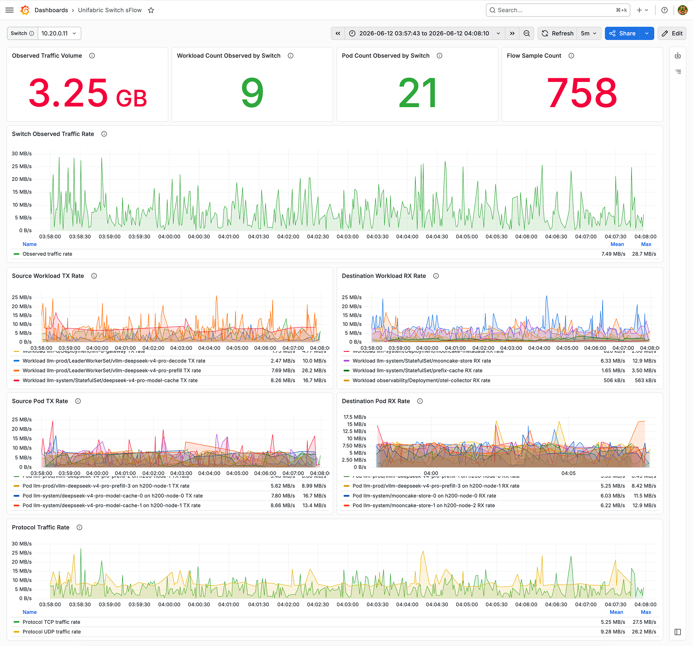
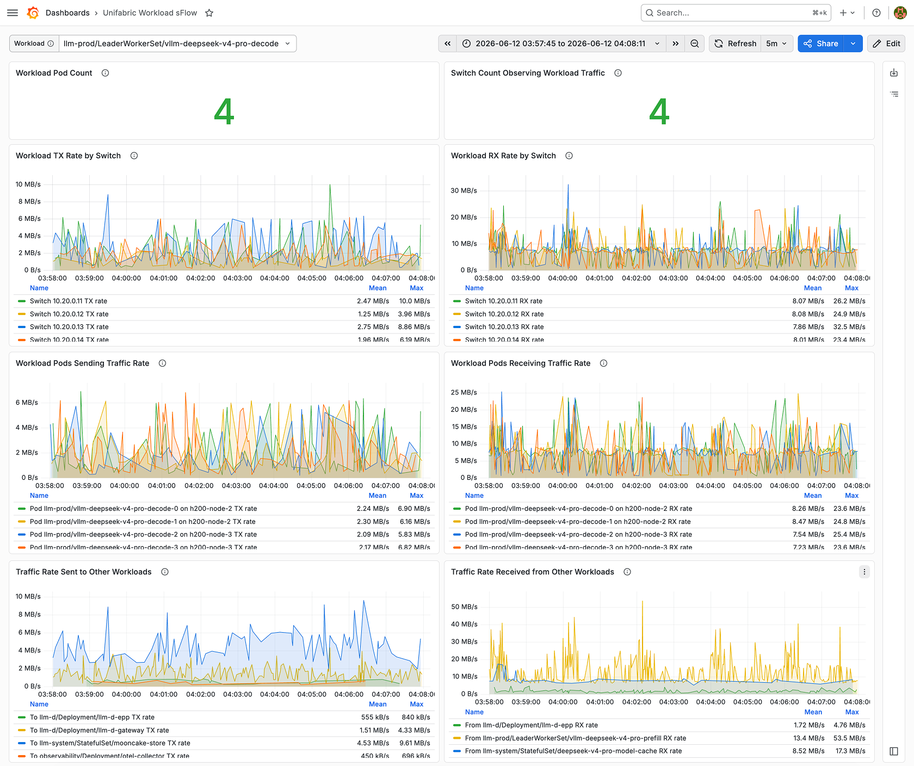

# Application Flow Observability Guide

This guide explains how Unifabric provides application flow observability. When enabled, Unifabric receives sampled traffic reported by multiple switches, decodes samples into queryable flow records, and enriches source and destination endpoints with Kubernetes Pod, Node, and workload owner metadata. Operators can inspect which applications communicate, which switches observe the traffic, and which Pods account for the main transmit and receive traffic from either the switch or workload perspective.

sFlow is the switch-side sampling input for this path. The collector exports enriched flow records as OTLP log records to the in-release OpenTelemetry Collector, which writes them into the Elasticsearch `unifabric-switch-sflow` data stream. Users mainly need to work with that data stream and the switch / workload dashboards built on it. For sFlow decoding, enrichment, and overload handling details, see [sFlow processing design](../design/sflow.md).

## Observation Model

The input for this capability is sFlow v5 datagrams pushed by switches. The collector extracts source address, destination address, protocol, ports, sampled bytes, sampled packets, sampling rate, and sampler address from datagrams, then converts each valid sample into a normalized flow record.

Before exporting, the collector matches source and destination IPs against the current Kubernetes Pod cache. A matched endpoint is enriched with Pod namespace, Pod name, Node name, and top-level workload owner. In this guide, "application" is represented by the Kubernetes top-level workload owner, such as Deployment, StatefulSet, DaemonSet, Job, and training or compute job objects that the current RBAC permissions allow the collector to read.

Endpoints that do not match a Pod IP are still exported with the base flow fields, while Kubernetes fields remain empty. These records can still be used for switch, IP, protocol, and time-range troubleshooting. If one side of the flow involves an in-cluster Pod, that side keeps the application attribution fields.

Derived fields are computed at export time, so dashboards and queries can use them directly:

- `scaled_bytes` and `scaled_packets`: sampled values multiplied by the sampling rate.
- `sampler_ip`, `src_ip`, `dst_ip`: string IP addresses.
- `protocol`: IP protocol name, such as `TCP` or `UDP`.
- `src_workload`, `dst_workload`: top-level owner as `namespace/kind/name`.

## Prerequisites

- A Kubernetes cluster where the Unifabric chart can be installed.
- An Elasticsearch target. The chart can deploy a bundled single-node test instance, or you can point `ebpfFlowEventCollector.elasticsearch.endpoints` at an external cluster.
- Switches that can send sFlow v5 datagrams to a Kubernetes Service address.
- Grafana dashboard import support if `grafanaDashboard.enabled=true`.

## Install Paths

Choose one of the following install paths based on where the data is stored. In all paths, the chart applies the required `unifabric-switch-sflow` index template and ILM policy before ingestion, so you do not need to create the data stream manually.

### 1. Use the Bundled Test Elasticsearch

Use this path for evaluation and test clusters. When `ebpfFlowEventCollector.elasticsearch.endpoints` is empty, the chart deploys a bundled single-node Elasticsearch with fixed credentials and no TLS. By default its data lives on an emptyDir and is lost on Pod recreation; set `ebpfFlowEventCollector.elasticsearch.bundled.persistence.enabled=true` to keep it on a PVC.

Create a values file:

```yaml
sflow:
  enabled: true
  service:
    type: NodePort
    port: 6343
    # Optional. Omit or set to 0 to let Kubernetes allocate a nodePort.
    nodePort: 0

ebpfFlowEventCollector:
  elasticsearch:
    enabled: true
```

This configuration renders the sFlow collector, UDP Service, the shared OpenTelemetry Collector with a dedicated sFlow OTLP port, the bundled Elasticsearch, and the sFlow Grafana datasource. The collector OTLP endpoint automatically points to the in-release Collector.

Save the content above as `sflow-values.yaml`, then run the following command. The same command works for both first-time install and updating an existing release. For an existing release, `--reuse-values` keeps the existing Helm values and applies the sFlow settings from this file.

```bash
helm upgrade --install unifabric ./chart \
  --namespace unifabric-system \
  --create-namespace \
  --reuse-values \
  --values sflow-values.yaml \
  --wait
```

### 2. Use External Elasticsearch

Use this path when production already has Elasticsearch, or when Elasticsearch capacity, backup, and high availability are managed by an external system. The Collector writes sFlow documents into the `unifabric-switch-sflow` data stream of the external cluster.

Create a values file:

```yaml
sflow:
  enabled: true
  service:
    type: NodePort
    port: 6343
    nodePort: 0

ebpfFlowEventCollector:
  elasticsearch:
    enabled: true
    endpoints:
      - http://elasticsearch.data.svc:9200
    user: elastic
    # Existing Secret with a `password` key. Alternatively set `password` inline.
    existingSecret: elasticsearch-auth
```

The configured Elasticsearch user needs permission to create ILM policies, index templates, and data streams, and to write documents. The Elasticsearch connection is shared with the RDMA flow event pipeline; sFlow data lands in its own data stream and does not mix with RDMA documents.

Save the content above as `sflow-external-es-values.yaml`, then run the same `helm upgrade --install` command as in path 1 with this file.

### 3. Use an External OpenTelemetry Collector

Use this path when you already operate an OpenTelemetry Collector and want to manage the Elasticsearch exporter and schema yourself. Set `sflow.otel.endpoint` to the OTLP gRPC address; the chart then skips the in-release Collector requirement, and you are responsible for the index template, ILM policy, and Grafana datasource.

```yaml
sflow:
  enabled: true
  otel:
    endpoint: otel-collector.observability.svc:4317
    insecure: true
    timeout: 10s
```

`NodePort` is used by default because switch sFlow traffic usually arrives from outside the cluster. Set `sflow.service.nodePort` when switches need a fixed UDP node port. Keep it as `0` to let Kubernetes allocate one automatically. If the environment supports external UDP load balancing, set `sflow.service.type` to `LoadBalancer`.

## Configure Switch Sampling Data

Configure the sFlow collector address and port on the switch. The following example enables sFlow on all ports on SONiC and sends sampled data to the Unifabric sFlow Service:

```bash
sudo config sflow collector add collector1 192.168.122.172 --port 6343
sudo config sflow interface enable all
sudo config sflow enable
sudo show sflow
```

Replace `192.168.122.172` and `6343` with the actual sFlow Service address and port. Check the Service first:

```bash
kubectl get svc -n unifabric-system unifabric-sflow
```

If the Service is `NodePort`, use a Kubernetes Node IP reachable from the switch and the nodePort shown in the output. If the Service is `LoadBalancer`, use the LoadBalancer IP and Service port shown in the output.

## Verify the Ingest and Export Path

Check rendered resources:

```bash
kubectl -n unifabric-system get deploy,svc,cm \
  -l 'app.kubernetes.io/component in (unifabric-sflow,unifabric-ebpf-flow-event-collector)'
kubectl -n unifabric-system get clusterrole,clusterrolebinding -l app.kubernetes.io/component=unifabric-sflow
```

The `ebpf-flow-event-collector` Deployment should be ready and expose the sFlow OTLP port 4319. When the bundled Elasticsearch is used, the `elasticsearch` Deployment should also be ready; its schema sidecar applies the index template and ILM policy after every start.

Check Pod status and logs:

```bash
kubectl -n unifabric-system get pods \
  -l 'app.kubernetes.io/component in (unifabric-sflow,unifabric-ebpf-flow-event-collector,unifabric-elasticsearch)'
kubectl -n unifabric-system logs deploy/unifabric-sflow -c sflow
```

Check the metrics endpoint from inside the cluster:

```bash
POD_IP=$(kubectl -n unifabric-system get pod -l app.kubernetes.io/component=unifabric-sflow -o jsonpath='{.items[0].status.podIP}')
kubectl -n unifabric-system run sflow-metrics-check --rm -i --restart=Never --image=curlimages/curl -- \
  "http://${POD_IP}:8084/metrics"
```

Useful metrics:

- `unifabric_sflow_datagrams_accepted_total`: datagrams received by the collector.
- `unifabric_sflow_decode_errors_total`: malformed or unsupported datagrams.
- `unifabric_sflow_records_decoded_total`: normalized records produced.
- `unifabric_sflow_records_written_total`: records handed to the OTLP exporter.
- `unifabric_sflow_records_dropped_total`: records dropped because the writer queue was full.
- `unifabric_sflow_write_errors_total`: OTLP export failures.
- `unifabric_sflow_queue_depth`: records currently queued for export.

## Verify Application Flow Records

Query recent traffic by source workload, destination workload, and switch. The examples use the bundled Elasticsearch credentials (`elastic` / `rdma-flow`); replace them for an external cluster.

```bash
ES_POD=$(kubectl -n unifabric-system get pod -l app.kubernetes.io/component=unifabric-elasticsearch -o jsonpath='{.items[0].metadata.name}')
kubectl -n unifabric-system exec "$ES_POD" -c elasticsearch -- \
  curl -fsS -u elastic:rdma-flow -H 'Content-Type: application/json' \
  'http://localhost:9200/unifabric-switch-sflow/_search' -d '{
    "size": 0,
    "query": {
      "bool": {
        "filter": [{"range": {"@timestamp": {"gte": "now-10m"}}}],
        "should": [
          {"exists": {"field": "src_workload"}},
          {"exists": {"field": "dst_workload"}}
        ],
        "minimum_should_match": 1
      }
    },
    "aggs": {
      "by_pair": {
        "multi_terms": {
          "terms": [
            {"field": "src_workload", "missing": "-"},
            {"field": "dst_workload", "missing": "-"},
            {"field": "sampler_ip"}
          ],
          "size": 20,
          "order": {"observed_bytes": "desc"}
        },
        "aggs": {
          "observed_bytes": {"sum": {"field": "scaled_bytes"}},
          "observed_packets": {"sum": {"field": "scaled_packets"}}
        }
      }
    }
  }'
```

Expected result: records involving current cluster Pods include workload owner fields on the matched source or destination side. When both endpoints match Pod IPs, you can see workload-to-workload traffic. When only one side matches, you can see traffic between in-cluster applications and external endpoints.

To inspect specific Pods, query recent raw documents:

```bash
kubectl -n unifabric-system exec "$ES_POD" -c elasticsearch -- \
  curl -fsS -u elastic:rdma-flow -H 'Content-Type: application/json' \
  'http://localhost:9200/unifabric-switch-sflow/_search' -d '{
    "size": 20,
    "sort": [{"@timestamp": "desc"}],
    "query": {"range": {"@timestamp": {"gte": "now-10m"}}},
    "_source": ["@timestamp", "sampler_ip", "src_pod_namespace", "src_pod_name",
                "src_node_name", "dst_pod_namespace", "dst_pod_name", "dst_node_name",
                "bytes", "packets", "sampling_rate"]
  }'
```

## Verify Dashboards

When `grafanaDashboard.enabled=true` and `sflow.enabled=true`, the chart renders:

- `switch-sflow.json`
- `workload-sflow.json`
- `workload-pair-sflow.json`

All three dashboards query Elasticsearch through the `unifabric-sflow-elasticsearch` datasource, which the chart creates when `sflow.elasticsearch.grafanaDatasource.enabled=true`.

The switch dashboard starts from the switch sampler address and shows workloads, Pods, samples, protocols, and top talkers observed by that switch.



The workload dashboard starts from the workload owner and shows transmit and receive traffic for the selected application, the switches that observed the traffic, related Pod distribution, and traffic from the selected application to other workloads or from other workloads to the selected application.



The workload pair dashboard starts from a source workload and destination workload and shows src-to-dst traffic and dst-to-src traffic, grouped by the switches that observed each direction.

Distinct-count stats, such as the Pod and workload counts, use Elasticsearch cardinality aggregations and are approximate. Source-side and destination-side counts are shown separately.

If dashboards are empty, first confirm the `unifabric-switch-sflow` data stream has documents in the selected time range, then check the dashboard data source and variables.

## Troubleshooting

If the collector does not become ready after installation:

- Check `unifabric-sflow` logs and confirm it can reach the configured OTLP endpoint.
- Confirm the `ebpf-flow-event-collector` Deployment is ready and listens on port 4319.
- When using the bundled Elasticsearch, confirm the `elasticsearch` Pod is ready and the schema sidecar applied the index template without errors.

If the collector is not receiving datagrams:

- Confirm the Service type and address are reachable from switches.
- Confirm switch exporters target UDP `6343`, or the configured `sflow.service.port`.
- Confirm Kubernetes NetworkPolicy or external firewalls allow UDP traffic.

If documents are written without Pod fields:

- Confirm the endpoint IP in the sampled record is a Pod IP, not only a Node address or a post-NAT address.
- Confirm the target Pod is running and already has a Pod IP.
- Confirm the collector RBAC can list Pods and read owner objects.
- Wait one Pod cache refresh interval after Pod creation, then check again.

If OTLP exports fail:

- Confirm `sflow.otel.endpoint` (when set) is a collector-reachable `host:port`.
- Check `unifabric_sflow_write_errors_total` and collector logs.
- Check the OpenTelemetry Collector logs for Elasticsearch export errors, and confirm the Elasticsearch credentials are valid.

If documents are missing expected fields:

- The `unifabric-switch-sflow` index template disables dynamic mapping. A new attribute needs a field in the template followed by a data stream rollover.

If records are dropped:

- Check `unifabric_sflow_queue_depth` and `unifabric_sflow_records_dropped_total`.
- Increase the switch sampling rate to reduce input volume.
- Increase `sflow.writer.queueSize` or `sflow.writer.batchSize`.
- Check OpenTelemetry Collector and Elasticsearch latency and resource usage.
