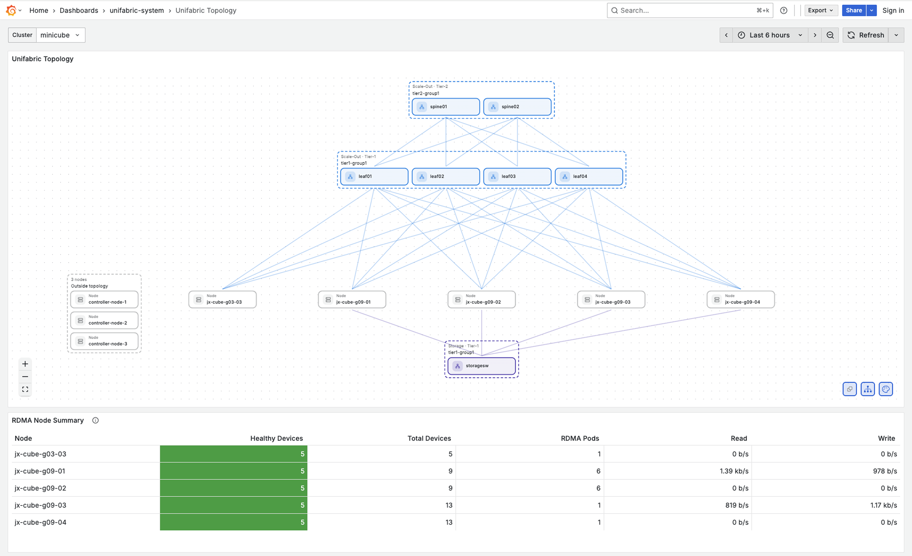

# Topology Visualization

中文版: [topology-visualization.zh.md](./topology-visualization.zh.md)

## Introduction

Topology visualization renders the discovered Scale-out, Scale-up, and Storage
topologies of the cluster as one interactive graph in Grafana. The feature reads only
the `Topology`, `FabricNode`, and `Switch` resources. It shows topology data that
discovery has already produced. It does not discover topology itself, and it does not
show live traffic or link utilization. A cluster without at least one populated
`Topology` resource renders an empty graph.

The feature has three parts. The Controller serves a Topology HTTP API. A Grafana
datasource plugin queries that API. A Grafana panel plugin renders the graph.

> **Note:** With NVIDIA Topograph sources (`nv-topograph` mode), switch member
> cards stay empty unless an administrator creates label-only `Switch` resources.
> See the [Topology CRD design](../design/topology-crd.md).

## Prerequisites

- Unifabric is installed through the [basic installation](../getting-started.md),
  and a scenario guide such as [SONiC RoCE](../getting-started-sonic-roce.md) is
  complete.
- Grafana Operator and its CRDs are installed in the cluster.
- The following command returns at least one `Topology` resource:

  ```bash
  kubectl get topologies.unifabric.io
  ```

  ```text
  NAME       AGE
  scaleout   4h27m
  scaleup    4h27m
  storage    4h27m
  ```

## Configuration and Usage

This feature has two cases. Use the bundled Grafana instance when the cluster has no
Grafana of its own. Use an external instance when another team already operates
Grafana.

### Case 1: Use the Bundled Grafana Instance

1. Enable the Topology API and the bundled Grafana instance. Run this command on a
   host with Helm access to the cluster:

   ```bash
   helm upgrade unifabric oci://ghcr.io/unifabric-io/charts/unifabric \
     --namespace unifabric-system \
     --reuse-values \
     --set topologyAPI.enabled=true \
     --set grafanaInstance.enabled=true \
     --wait
   ```

   ```text
   <!-- TODO: capture output from a real environment -->
   ```

   The chart creates a `Grafana`, a `GrafanaDatasource`, and a `GrafanaDashboard`.
   The datasource connects to the Controller Topology API from the same release. The
   bundled image `ghcr.io/unifabric-io/unifabric-grafana:<version>` contains both
   plugins.

   > **Warning:** The Topology API has no authentication of its own. In production,
   > pair `topologyAPI.enabled=true` with a NetworkPolicy or an ingress rule that
   > restricts access to the Grafana instance. Without it, any Pod in the cluster can
   > read the topology.

2. Get the node port and the login credentials. The Service type defaults to NodePort
   with a random port:

   ```bash
   kubectl get service -n unifabric-system unifabric-grafana-service
   kubectl get secret -n unifabric-system unifabric-grafana-admin-credentials \
     -o go-template='{{range $k, $v := .data}}{{$k}}: {{$v | base64decode}}{{"\n"}}{{end}}'
   ```

   ```text
   <!-- TODO: capture output from a real environment -->
   ```

3. Open `http://<node IP>:<NodePort>` in a browser, log in, then search for and open
   the `Unifabric Topology` dashboard.

### Case 2: Use an External Grafana Instance

1. Enable only the Topology API:

   ```bash
   helm upgrade unifabric oci://ghcr.io/unifabric-io/charts/unifabric \
     --namespace unifabric-system \
     --reuse-values \
     --set topologyAPI.enabled=true \
     --wait
   ```

   ```text
   <!-- TODO: capture output from a real environment -->
   ```

   The chart creates a `GrafanaDatasource` and a `GrafanaDashboard` and selects the
   external instance through `grafanaDashboard.instanceSelector`. The default selector
   is `{}`.

   > **Note:** If the cluster contains more than one Grafana instance, set the
   > selector to match the intended instance. Otherwise the dashboard can land on the
   > wrong Grafana. For example, when the external `Grafana` resource has a
   > `dashboards: grafana` label, set:
   >
   > ```yaml
   > grafanaDashboard:
   >   instanceSelector:
   >     matchLabels:
   >       dashboards: grafana
   > ```

2. Install the plugins into the external instance. If the instance can use the
   Unifabric Grafana image, update `spec.version` in its `Grafana` resource:

   ```yaml
   spec:
     version: ghcr.io/unifabric-io/unifabric-grafana:<version>
   ```

   If the instance must keep its current image, install the plugins with an init
   container. The configuration below assumes that the `grafana-plugins` shared volume
   is mounted at `/var/lib/grafana/plugins` in the Grafana container. It also allows
   Grafana to load the two unsigned plugins:

   ```yaml
   spec:
     config:
       plugins:
         allow_loading_unsigned_plugins: unifabric-unifabrictopology-datasource,unifabric-unifabrictopology-panel
     deployment:
       spec:
         template:
           spec:
             initContainers:
               - name: unifabric-plugins-init
                 image: ghcr.io/unifabric-io/unifabric-grafana:<version>
                 command:
                   - /bin/sh
                   - -c
                 args:
                   - |
                     set -eu
                     for plugin in \
                       unifabric-unifabrictopology-datasource \
                       unifabric-unifabrictopology-panel
                     do
                       test -f "/var/lib/grafana/plugins/${plugin}/plugin.json"
                       rm -rf "/opt/plugins/${plugin}"
                       cp -a "/var/lib/grafana/plugins/${plugin}" /opt/plugins/
                     done
                 volumeMounts:
                   - name: grafana-plugins
                     mountPath: /opt/plugins
   ```

   > **Note:** If the shared volume has a different name, update
   > `volumeMounts[].name` in the init container to match it.

3. After you apply the resource, wait for Grafana Operator to reconcile it. Make sure
   that both plugin directories exist in the Grafana Pod.

### Read the Dashboard



The graph uses four vertical regions. Scale-out domains appear above the Node row,
with tier 1 closest to the Nodes. Scale-up domains appear between Scale-out and the
Node row. Node cards form the shared row that all topology types use. Storage domains
appear below the Node row.

Each domain card shows its topology type, tier, domain name, and member switches.
Lines show parent relationships and Node membership. Select a domain, a switch, or a
Node to emphasize its direct connections. Select it again, or select the empty canvas,
to clear the selection. Use the controls in the lower-left corner to zoom or to fit
the graph into the panel.

Hover over a card to inspect the resource behind it. A Node card loads the matching
`FabricNode`. A switch card loads the matching `Switch`. The detail popover includes a
`View raw JSON` action.

## Verification

Open the `Unifabric Topology` dashboard in Grafana. The verification passes when the
graph shows the expected domain cards, the Node row, and the connection lines that
match the physical fabric.


<!-- TODO: capture a screenshot from a real environment -->

## Troubleshooting

### The Dashboard Is Not Imported

First make sure that the preconditions hold:

1. Make sure that `topologyAPI.enabled=true`.
2. Make sure that `grafanaDashboard.enabled=true`. The default is `true`. Enable it
   again if it was disabled during installation.
3. Make sure that `grafanaDashboard.kind=GrafanaDashboard` and that the target Grafana
   instance matches `grafanaDashboard.instanceSelector`.

### The Graph Has No Topology Domains

1. Make sure that `kubectl get topologies` returns resources and that each resource
   has `status.domains` and `status.nodes`.
2. Make sure that topology discovery is complete. See the verification steps in the
   [SONiC RoCE guide](../getting-started-sonic-roce.md).
3. Make sure that the Cluster selection of the dashboard matches the API cluster name.

### Nodes Appear Under Outside Topology

The panel builds this group by comparing `FabricNode.metadata.name` with every Node
name in `Topology.status.nodes`. Inspect the topology labels of the affected Node and
the current `Topology` resources. After discovery updates the status, refresh the
dashboard.

### A Switch or Node Detail Shows Not Found

The domain stays visible from a `Topology` resource even when the referenced `Switch`
or `FabricNode` resource is absent. Make sure that the referenced resource exists with
`kubectl get switch <name>` or `kubectl get fabricnode <name>`.

## References

- [FabricNode reference](../reference/fabricnode.md): fields that the Node detail popover shows.
- [Topology CRD design](../design/topology-crd.md): how the topology data model works.
- [Topology visualization design](../design/topology-visualization.md): the API and plugin architecture.
