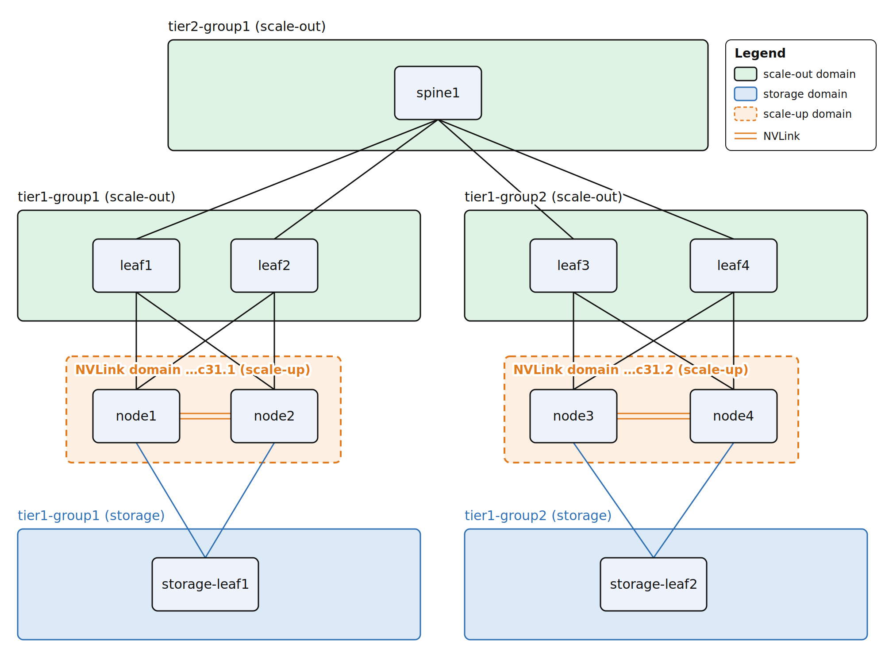

# 网络拓扑发现

English version: [README.md](./README.md)

## 简介

Unifabric 网络拓扑发现探测 AI 集群中主机与交换机、交换机与交换机之间的连接关系。
它把结果写成 Kubernetes 资源。
调度器用这些资源做拓扑亲和调度,运维用它们查看全局拓扑。

拓扑发现支持以下网络类型:

- Scale-out 网络: 承载 GPU 跨节点通信,采用 leaf-spine 架构。
- Storage 网络: 承载节点到高速存储的流量。
- Scale-up 网络: GPU 之间的高速互联,例如 NVIDIA NVLink。

拓扑发现覆盖以下范围:

- 主机的拓扑层级: 主机接在哪台 leaf 交换机下,属于哪个 spine 域。
- leaf 和 spine 交换机的拓扑层级: 交换机之间的上下联关系。

拓扑发现把结果写成两种资源:

- 分层 Node label。它记录每个节点所在的交换机域,调度器直接消费。物理拓扑变化时,label 自动更新。
- `Switch` 和 `Topology` 资源。每台交换机成为一个 `Switch` 资源,每张网络成为一个 `Topology` 资源。Grafana 可以把它们渲染成实时的全局拓扑图。

网络设备可以是 SONiC 交换机、NVIDIA Spectrum 交换机或 InfiniBand。
无论哪种设备,结果都使用同一套 label 模型和同一个 `Topology` 资源。

通过本文你将学习到:

- 每张网络在不同网络设备上使用哪种发现方式,以及 Unifabric 当前是否支持。
- 各发现方式如何工作,对网络设备和集群有哪些要求。
- 如何查看结果: Node label、`Topology` 资源和 Grafana 拓扑图。
- Kueue、Volcano、KAI Scheduler 等调度器如何消费这些 label。

## 背景

一个节点上的 GPU 数量和显存有限,通常是 8 张 GPU。
大部分训练任务和推理任务无法在一个节点内完成。
它们的 Pod 必须运行在多个节点上:

- 训练任务: 大模型的参数、梯度和优化器状态远超单节点的显存。训练任务使用数据并行、张量并行、流水线并行等方式。这些方式把模型和数据切分到数十到数千张 GPU 上。
- 推理任务: 大模型的权重本身就可能超出单节点的显存,所以模型必须跨节点运行。在 PD 分离 (prefill-decode disaggregation) 场景下,Prefill 阶段是计算密集型,Decode 阶段是显存带宽密集型。两者运行在同一个节点上会争抢 GPU 资源。这样两者的时延都会升高,吞吐都会下降。因此 Prefill 实例和 Decode 实例通常运行在不同的节点上,各自独立扩缩容。

这些 Pod 之间的 GPU 通信走 Scale-out 网络。
如果两个 Pod 接在同一台 leaf 交换机下,流量只经过这一台交换机。
如果它们接在不同的 leaf 交换机下,流量要经过 spine。
路径更长,时延更高,并且其他任务的流量会在上层链路上相互干扰。
因此,这类任务需要拓扑亲和调度。
调度器尽量把同一个任务的 Pod 放在同一个 leaf 域或 spine 域内。

Kueue、Volcano 和 KAI Scheduler 都支持拓扑亲和调度,但它们看不到物理网络。
它们只读取 Node 上的拓扑 label。
要让调度器工作,必须有一种机制把每个节点在网络中的位置作为 label 记录在 Node 对象上。

这带来两个问题:

- 拓扑 label 没有可靠的来源。

  物理连接关系散落在多家厂商的交换机、网卡和网络管理平台里。
  各厂商的工具互不相通,也不与 Kubernetes 对接。
  在数百台节点的集群里,人工给每个节点打 label 很慢,而且容易出错。
  交换机扩容或换线之后,label 不会跟着变,与实际拓扑不再一致。

- 运维没有一张全局的网络拓扑图。

  节点、leaf 交换机、spine 交换机之间的全部连接关系不在任何一个地方呈现。
  训练任务可能变慢,链路也可能报错。
  这时运维要先从交换机、网卡和厂商平台收集数据。
  他们要找出哪些节点接在同一台 leaf 下,每条链路承载了哪些任务。
  然后才能去定位故障。
  在数百台节点、几十台交换机的集群里,仅这一步就要花很长时间。

网络拓扑发现解决这两个问题:

- 分层 Node label 让调度器拿到准确、实时的拓扑。

- `Topology` 资源和 Grafana 拓扑图让运维在出现故障时看到受影响的节点和任务。

## 前提条件

- 已按[基础安装](../../getting-started.zh.md)完成 Unifabric 部署。
- `kubectl get fabricnodes` 中每个节点的 `READY` 为 `True`,并且网卡归类正确。基础安装的验证小节覆盖这一步。
- 仅拓扑可视化需要: 集群已安装 Grafana Operator 及其 CRD。

各发现方式对网络设备和集群的其他要求,参见[发现方式](#发现方式)中的对应小节。

## 按网络选择发现方式

三张网络相互独立。
每张网络在 Helm values 中有自己的发现模式。
一个集群可以同时使用不同的发现方式。
例如 Scale-out 网络使用 InfiniBand 网络发现,Storage 网络使用 RoCE 网络中 LLDP 发现。

> 注意: 如果 Scale-out 网络和 Scale-up 网络都设置为 `nv-topograph`,两者共用一个 NVIDIA Topograph 实例和一个 provider (`nvidiaTopograph.provider.name`)。

在每张网络的表中找到你的网络设备,确定发现方式。
然后到[发现方式](#发现方式)中查看要求和配置。

"支持情况"列中各值的含义:

| 支持情况 | 含义 |
| --- | --- |
| 已支持 | Unifabric 已实现。 |
| 未验证 | Unifabric 已实现,但未在该网络设备上测试。 |
| 暂不支持 | 有拓扑数据来源,技术上可行,但 Unifabric 尚未实现。 |
| 不支持 | 没有拓扑数据来源,无法自动发现。 |
| 不适用 | 不需要拓扑发现。 |

### Scale-out 网络

| 网络设备 | 发现方式 | Helm 配置 | 支持情况 |
| --- | --- | --- | --- |
| 运行 SONiC 的以太网 RoCE 交换机,能运行 switch-agent | [RoCE 网络中 LLDP 发现](./roce-lldp-discovery.zh.md) | `topoDiscovery.scaleOut.mode=unifabric-roce` (默认) | 已支持 |
| NVIDIA Spectrum-X 交换机,由 NetQ 管理 | [RoCE 网络中 NVIDIA NetQ 发现](./roce-netq-discovery.zh.md) | `topoDiscovery.scaleOut.mode=nv-topograph`,`nvidiaTopograph.provider.name=netq` | 已支持 |
| NVIDIA Spectrum-X 交换机,没有 NetQ | [RoCE 网络中 LLDP 发现](./roce-lldp-discovery.zh.md) | `topoDiscovery.scaleOut.mode=unifabric-roce` | 未验证 |
| NVIDIA InfiniBand 交换机 | [InfiniBand 网络发现](./infiniband-discovery.zh.md) | `topoDiscovery.scaleOut.mode=nv-topograph`,`nvidiaTopograph.provider.name=infiniband-k8s` (默认) | 已支持 |
| 以太网交换机,面向节点的端口发送 LLDP,但不能运行 switch-agent | [自定义网络拓扑](./custom-network-topology.zh.md) | `topoDiscovery.scaleOut.mode=unifabric-roce` | 已支持 |
| 以太网交换机,面向节点的端口不发送 LLDP | 无 | 无 | 不支持 |

### Storage 网络

| 网络设备 | 发现方式 | Helm 配置 | 支持情况 |
| --- | --- | --- | --- |
| 运行 SONiC 的以太网 RoCE 交换机,能运行 switch-agent | [RoCE 网络中 LLDP 发现](./roce-lldp-discovery.zh.md) | `topoDiscovery.storage.mode=unifabric-roce` (默认),并配置存储网卡的 selector | 已支持 |
| NVIDIA Spectrum-X 交换机,由 NetQ 管理 | Unifabric 暂不能从 NetQ 导入的拓扑中识别 Storage 网络。改用 [RoCE 网络中 LLDP 发现](./roce-lldp-discovery.zh.md) (未验证) 或[自定义网络拓扑](./custom-network-topology.zh.md)。 | `topoDiscovery.storage.mode=unifabric-roce` | 暂不支持 |
| NVIDIA Spectrum-X 交换机,没有 NetQ | [RoCE 网络中 LLDP 发现](./roce-lldp-discovery.zh.md) | `topoDiscovery.storage.mode=unifabric-roce` | 未验证 |
| NVIDIA InfiniBand 交换机 | Unifabric 暂不能从 [InfiniBand 网络发现](./infiniband-discovery.zh.md)的拓扑中识别 Storage 网络。InfiniBand 网卡收不到 LLDP,所以节点找不到自己的 leaf。因此 RoCE 网络中 LLDP 发现和自定义网络拓扑都不可用。 | 无 | 暂不支持 |
| 以太网交换机,面向节点的端口发送 LLDP,但不能运行 switch-agent | [自定义网络拓扑](./custom-network-topology.zh.md) | `topoDiscovery.storage.mode=unifabric-roce` | 已支持 |
| 以太网交换机,面向节点的端口不发送 LLDP | 无 | 无 | 不支持 |

### Scale-up 网络

Scale-up 网络是 GPU 之间的高速互联,例如 NVIDIA NVLink。
它的硬件是 GPU 互联本身。
它不依赖 Scale-out 网络和 Storage 网络的交换机。

只有多节点 NVLink 系统需要 Scale-up 拓扑发现。
例如 GB200 NVL72 用 NVLink Switch 把一个机柜内的 72 张 GPU 连成一个 NVLink 域。
这个域跨多个 Kubernetes 节点。
在单节点 NVLink 系统中,例如 HGX 8 卡,一个节点就是一个 NVLink 域,不需要发现。

| GPU 互联 | 发现方式 | Helm 配置 | 支持情况 |
| --- | --- | --- | --- |
| 单节点 NVLink,例如 HGX 8 卡 | 不需要 | `topoDiscovery.scaleUp.mode=manual` (默认) | 不适用 |
| 多节点 NVLink,NVLink 域由 NetQ 管理 | [通过 NVIDIA NetQ 发现 NVLink 域](./roce-netq-discovery.zh.md) | `topoDiscovery.scaleUp.mode=nv-topograph`,`nvidiaTopograph.provider.name=netq` | 已支持 |
| 多节点 NVLink,Scale-out 网络是 InfiniBand | [InfiniBand 网络发现](./infiniband-discovery.zh.md)。它读取 GPU Operator 的 `nvidia.com/gpu.clique` label。 | `topoDiscovery.scaleUp.mode=nv-topograph`,`nvidiaTopograph.provider.name=infiniband-k8s` | 已支持 |
| 多节点 NVLink,没有 NetQ,Scale-out 网络也不是 InfiniBand | 由管理员写入 label | `topoDiscovery.scaleUp.mode=manual` | 暂不支持 |
| 非 NVIDIA 的 GPU 互联 | 由管理员写入 label | `topoDiscovery.scaleUp.mode=manual` | 暂不支持 |

## 发现方式

各方式只有拓扑来源不同。
结果相同,都在[验证](#验证)中查看。
每种方式的原理、要求、限制和配置步骤,参见对应的文档。

| 发现方式 | 适用网络 | 原理 |
| --- | --- | --- |
| [RoCE 网络中 LLDP 发现](./roce-lldp-discovery.zh.md) | Scale-out、Storage | 节点读取网卡的 LLDP 邻居。每台交换机上的 switch-agent 读取交换机的 LLDP 邻居。Controller 合并两者计算层级。 |
| [自定义网络拓扑](./custom-network-topology.zh.md) | Scale-out、Storage | 节点侧 LLDP 发现 leaf。`Switch` 资源上的邻居声明给出 spine 及以上的层级。交换机上不运行任何软件。 |
| [RoCE 网络中 NVIDIA NetQ 发现](./roce-netq-discovery.zh.md) | Scale-out、Storage、Scale-up | NVIDIA Topograph 通过 NetQ API 读取 fabric 拓扑和 NVLink 域。 |
| [InfiniBand 网络发现](./infiniband-discovery.zh.md) | Scale-out、Storage | NVIDIA Topograph 在一个 GPU 节点上运行 `ibnetdiscover`,读取 IB 子网的拓扑。 |

## 验证

### 查看 Topology 与 Node label

本节以一个集群为例。
三张网络的连接如下:

- Scale-out 网络是 SONiC RoCE。`node1` 和 `node2` 同时接入 `leaf1` 和 `leaf2`。`node3` 和 `node4` 同时接入 `leaf3` 和 `leaf4`。四台 leaf 交换机都接入 `spine1`。
- Storage 网络只有一层 leaf。`node1` 和 `node2` 接入 `storage-leaf1`。`node3` 和 `node4` 接入 `storage-leaf2`。
- Scale-up 网络有两个 NVLink 域。`node1` 和 `node2` 在一个域。`node3` 和 `node4` 在另一个域。



图中的 NVLink 域名是缩写。
完整格式为 `ClusterUUID.CliqueId`。
参见下文 `scaleup` 资源的示例。

发现完成后,查看 Scale-out 网络的 label:

```bash
kubectl get nodes \
  -L scale-out.unifabric.io/tier-1,scale-out.unifabric.io/tier-2
```

```text
NAME    STATUS   ROLES    AGE   VERSION   SCALE-OUT.UNIFABRIC.IO/TIER-1   SCALE-OUT.UNIFABRIC.IO/TIER-2
node1   Ready    <none>   30d   v1.32.0   tier1-group1                    tier2-group1
node2   Ready    <none>   30d   v1.32.0   tier1-group1                    tier2-group1
node3   Ready    <none>   30d   v1.32.0   tier1-group2                    tier2-group1
node4   Ready    <none>   30d   v1.32.0   tier1-group2                    tier2-group1
```

`node1` 和 `node2` 的 `tier-1` 值相同,所以它们在同一个 leaf 域。
四个节点的 `tier-2` 值相同,所以它们共享一个 spine 域。
如果节点有 `tier-1` 但没有 `tier-2`,说明 Unifabric 没有发现 leaf 以上的层级。
参见[故障排查](#故障排查)。

Storage 网络和 Scale-up 网络使用同一套模型,各有自己的 label 前缀。
示例中 Storage 网络只有一层 leaf:

```bash
kubectl get nodes -L storage.unifabric.io/tier-1
```

```text
NAME    STATUS   ROLES    AGE   VERSION   STORAGE.UNIFABRIC.IO/TIER-1
node1   Ready    <none>   30d   v1.32.0   tier1-group1
node2   Ready    <none>   30d   v1.32.0   tier1-group1
node3   Ready    <none>   30d   v1.32.0   tier1-group2
node4   Ready    <none>   30d   v1.32.0   tier1-group2
```

对于 Scale-up 网络,执行 `kubectl get nodes -L scale-up.unifabric.io/tier-1`。
值是 NVLink 域 ID。
Topograph 从 GPU Operator 的 clique label 或 NetQ 得到这个值。
值相同的节点共享一个 NVLink 域。

三张网络的 label 模型:

| Node label | 含义 |
| --- | --- |
| `scale-out.unifabric.io/tier-1` | 节点直连的 Scale-out 网络 leaf 交换机域 |
| `scale-out.unifabric.io/tier-2` | leaf 之上的 Scale-out 网络 spine 域 |
| `scale-out.unifabric.io/tier-3` | spine 之上的 Scale-out 网络 core 域 |
| `storage.unifabric.io/tier-N` | Storage 网络的对应层级。规则与 Scale-out 网络相同。 |
| `scale-up.unifabric.io/tier-1` | 节点所属的 NVLink 域 |

tier 数字越大,表示层级越靠近网络上层。
两个节点的某个 label 值相同时,它们在同一个性能域。
RoCE 网络中 LLDP 发现把域命名为 `tier<N>-group<M>`。
Topograph 使用自己的命名,例如 InfiniBand 交换机的 `S-fc6a1c03006636c0`。

Helm value `topoDiscovery.<fabric>.nodeLabel.keyTemplate` 定义 label key。
默认值为 `scale-out.unifabric.io/tier-{{ .Tier }}`、`storage.unifabric.io/tier-{{ .Tier }}` 和 `scale-up.unifabric.io/tier-{{ .Tier }}`。
你可以修改模板,但模板必须且只能包含一个 `{{ .Tier }}`。

> 注意: 如果修改了 key 模板,也要修改调度器配置中的 label key。否则调度器读不到任何拓扑信息。

每张网络有一个 `Topology` 资源: `scaleout`、`storage` 和 `scaleup`。
它汇总性能域的层级关系和每个节点的域路径:

> 注意: 当前暂不支持多平面 (multi-plane) 的 Scale-out 网络,例如 2、4 或 8 个平面。
> 所有平面只对应一个 `scaleout` 资源和一套 `scale-out.unifabric.io/tier-N` label。
> 如果节点接入多个平面,各平面的交换机会被合并到同一组域中,结果不能反映每个平面各自的拓扑。
> 后续版本计划支持多平面。

```bash
kubectl get topologies.unifabric.io
```

```text
NAME       AGE
scaleout   30d
scaleup    30d
storage    30d
```

在 `status.domains` 中,`switchMember` 列出域中的交换机。
`parent` 指向上一层的域。
最高层的域没有 `parent`。
在 `status.nodes` 中,每一组节点共享一条自上而下的域路径 `switchDomainPath`。
`name` 是该组节点的稳定标识。
字段的完整说明参见 [Topology 参考](../../reference/topology.zh.md)。

Scale-out 网络。示例中有 leaf 和 spine 两层:

```bash
kubectl get topologies.unifabric.io scaleout -o yaml
```

```yaml
apiVersion: unifabric.io/v1beta1
kind: Topology
metadata:
  name: scaleout
status:
  domains:
    - name: tier2-group1
      switchMember:
        - spine1
      tier: 2
    - name: tier1-group1
      parent: tier2-group1
      switchMember:
        - leaf1
        - leaf2
      tier: 1
    - name: tier1-group2
      parent: tier2-group1
      switchMember:
        - leaf3
        - leaf4
      tier: 1
  nodes:
    - name: node-group1
      nodes:
        - node1
        - node2
      switchDomainPath:
        - tier2-group1
        - tier1-group1
    - name: node-group2
      nodes:
        - node3
        - node4
      switchDomainPath:
        - tier2-group1
        - tier1-group2
```

Storage 网络。示例中只有一层 leaf。
tier 1 就是最高层,所以这些域没有 `parent`:

```bash
kubectl get topologies.unifabric.io storage -o yaml
```

```yaml
apiVersion: unifabric.io/v1beta1
kind: Topology
metadata:
  name: storage
status:
  domains:
    - name: tier1-group1
      switchMember:
        - storage-leaf1
      tier: 1
    - name: tier1-group2
      switchMember:
        - storage-leaf2
      tier: 1
  nodes:
    - name: node-group1
      nodes:
        - node1
        - node2
      switchDomainPath:
        - tier1-group1
    - name: node-group2
      nodes:
        - node3
        - node4
      switchDomainPath:
        - tier1-group2
```

Scale-up 网络。它只有 tier 1,即 NVLink 域。
域名是 `scale-up.unifabric.io/tier-1` label 的值。
由 Topograph 写入时,格式为 `ClusterUUID.CliqueId`。
Scale-up 网络没有 `Switch` 资源,所以没有 `switchMember`:

```bash
kubectl get topologies.unifabric.io scaleup -o yaml
```

```yaml
apiVersion: unifabric.io/v1beta1
kind: Topology
metadata:
  name: scaleup
status:
  domains:
    - name: 7b968a6d-c8aa-45e1-9e07-e1e51be99c31.1
      tier: 1
    - name: 7b968a6d-c8aa-45e1-9e07-e1e51be99c31.2
      tier: 1
  nodes:
    - name: node-group1
      nodes:
        - node1
        - node2
      switchDomainPath:
        - 7b968a6d-c8aa-45e1-9e07-e1e51be99c31.1
    - name: node-group2
      nodes:
        - node3
        - node4
      switchDomainPath:
        - 7b968a6d-c8aa-45e1-9e07-e1e51be99c31.2
```

#### 在调度器中使用 Node label

拓扑亲和调度器把 Node label 组织成自上而下的层级。
然后它逐层放置一个任务的 Pod。
下表把 Unifabric 的 label 对应到各调度器的配置入口。
调度器本身的安装和配置,以其官方文档为准:

| 调度器 | 配置入口 | 填写的 Unifabric label |
| --- | --- | --- |
| Kueue Topology Aware Scheduling | `Topology` 资源的 `spec.levels` | 自上而下: `scale-out.unifabric.io/tier-3`、`tier-2`、`tier-1`,最后是 `kubernetes.io/hostname` |
| Volcano network topology aware scheduling | `HyperNode` 资源 | 每个 tier 创建一个 HyperNode。成员选择器引用对应的 label。 |
| KAI Scheduler topology aware scheduling | `Topology` 资源的 `spec.levels` | 与 Kueue 相同 |

参考: [Kueue TAS](https://kueue.sigs.k8s.io/docs/concepts/topology_aware_scheduling/)、
[Volcano network topology](https://volcano.sh/en/docs/network_topology_aware_scheduling/)、
[KAI Scheduler](https://github.com/NVIDIA/KAI-Scheduler)。

### 查看拓扑可视化

Grafana 拓扑仪表盘把每个 `Topology` 资源渲染成交互式图形。
图形与上面的 Node label 对应。
每个 tier 1 域是一个 leaf 分组。
每个 tier 2 域是 leaf 分组之上的 spine 分组。
每个节点位于它所属的 leaf 分组下。


仪表盘的安装、外部 Grafana 的接入以及图形的详细说明,参见[拓扑可视化](./topology-visualization.zh.md)。

## 故障排查

### Node 上没有任何拓扑 label

先确认前提条件已满足:

1. 对于 RoCE 网络中 LLDP 发现和自定义网络拓扑,确认 `FabricNode` 中的网卡已收到 LLDP 邻居:

   ```bash
   kubectl get fabricnode node1 -o jsonpath='{range .status.scaleOutNics[*]}{.name}{"\t"}{.lldpNeighbor.hostname}{"\t"}{.lldpNeighbor.port}{"\n"}{end}'
   ```

   ```text
   eth1	leaf1	Ethernet0
   eth2	leaf2	Ethernet0
   ```

   如果 hostname 列为空,确认交换机已启用 LLDP。
   同时确认节点网卡对应的交换机端口发送 LLDP 报文。
   `FabricNode` 的 `LLDPNeighborsReady` condition 也会报告原因 `LLDPNeighborMissing`。

2. 对于 RoCE 网络中 NVIDIA NetQ 发现和 InfiniBand 网络发现,确认 `mode` 为 `nv-topograph`,并且 Topograph Deployment 在运行:

   ```bash
   kubectl -n unifabric-system get deployment unifabric-nvidia-topograph
   kubectl -n unifabric-system logs deployment/unifabric-nvidia-topograph --tail 100
   ```

   对于 RoCE 网络中 NVIDIA NetQ 发现,检查 NetQ 凭据和 API 地址。
   确认 Topograph Pod 能连接 NetQ API。
   对于 InfiniBand 网络发现,确认日志显示 `ibnetdiscover` 正常运行。

3. 查看 Controller 日志:

   ```bash
   kubectl -n unifabric-system logs deployment/unifabric-controller --tail 200
   ```

### Node label 只有 tier 1

节点侧 LLDP 只发现 leaf 层。
这个现象说明 leaf 层以上的信息没有到达 Controller:

- RoCE 网络中 LLDP 发现: 确认每台交换机都有 `Switch` 资源。同时确认 `kubectl get switch -o wide` 中 `HEALTHY` 为 `true`。如果为 `false`,确认运行 Controller 的节点能连接交换机的 `8090` 端口。同时确认 mTLS 证书匹配。参见 [RoCE 网络中 LLDP 发现](./roce-lldp-discovery.zh.md#故障排查)。
- 自定义网络拓扑: 确认 spine 层及以上的每台交换机都有 `Switch` 资源。同时确认每个资源都有 `unifabric.io/switch-neighbors` annotation。参见[自定义网络拓扑](./custom-network-topology.zh.md#故障排查)。
- 如果物理网络只有一层 leaf,只有 tier 1 是预期结果。

### 拓扑可视化中交换机成员为空

这是 RoCE 网络中 NVIDIA NetQ 发现和 InfiniBand 网络发现的预期行为。
参见[创建 Switch 实例](./topograph-switch-resources.zh.md)。

## 参考

- [拓扑发现概念](../../concepts/topology-discovery.zh.md): 逻辑拓扑、发现方式和发现结果。
- [RoCE 网络中 LLDP 发现](./roce-lldp-discovery.zh.md)、[自定义网络拓扑](./custom-network-topology.zh.md)、[RoCE 网络中 NVIDIA NetQ 发现](./roce-netq-discovery.zh.md)、[InfiniBand 网络发现](./infiniband-discovery.zh.md): 各发现方式的原理、要求和配置。
- [创建 Switch 实例](./topograph-switch-resources.zh.md): RoCE 网络中 NVIDIA NetQ 发现和 InfiniBand 网络发现的可选步骤。
- [拓扑可视化](./topology-visualization.zh.md): Grafana 仪表盘的安装和解读。
- [Topology 参考](../../reference/topology.zh.md)、[FabricNode 参考](../../reference/fabricnode.zh.md)、[Switch 参考](../../reference/switch.zh.md)。
- [Scale-out 拓扑发现设计](../../design/scaleout-topology.zh.md)、[Topology CRD 设计](../../design/topology-crd.zh.md)。
- [Helm values 参考](../../../chart/README.md): 全部 `topoDiscovery.*` 参数。
