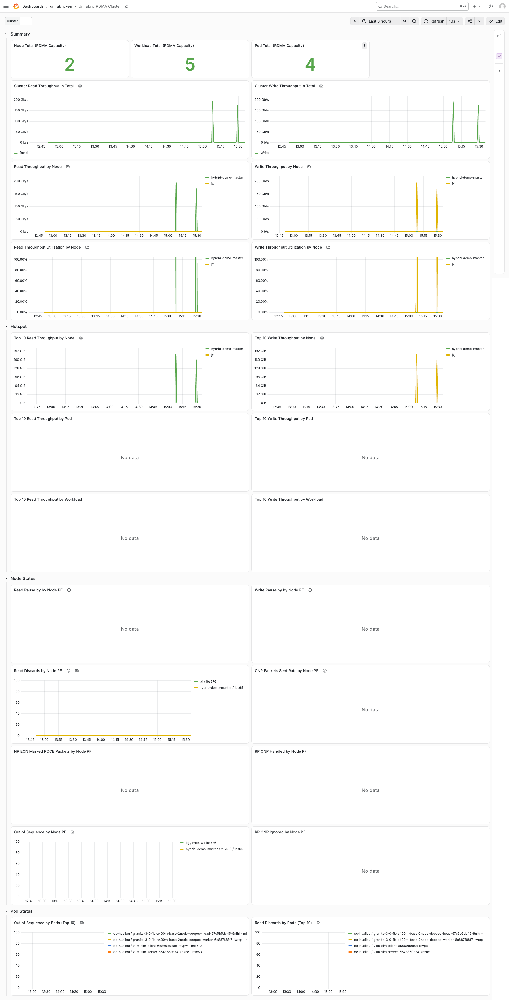

# 主机与 Pod 的 RDMA 网卡指标

> 成熟度: Stable

English version: [rdma-metrics.md](./rdma-metrics.md)

## 简介

Agent 在每个节点上采集 RDMA 网卡的计数器,并以 Prometheus 指标的形式导出。指标同时覆盖主机的 RDMA 网卡和 Pod 使用的 RDMA 设备,内容包括吞吐、拥塞、错误与重传,以及各优先级的 pause 和丢弃。每个样本都带有网络类型标签,Pod 的样本还额外带有 Pod 及其所属训练或推理任务的标签。

本文说明如何配置、验证和查看这些指标。

| 项目 | 说明 |
| --- | --- |
| 观测对象 | 主机的 RDMA 网卡和 Pod 使用的 RDMA 设备 |
| 适用网络 | Scale-out、Storage、Scale-up 中的 RDMA 网卡 |
| 数据来源 | sysfs 中的 RDMA 计数器和网卡属性,ethtool 优先级计数器 |
| 统计维度 | 节点、网卡、Pod、workload |
| 输出 | `unifabric_*` 指标,Grafana 中的 RDMA 集群、节点、Pod 和 AI Workload 仪表盘 |
| 节点侧要求 | Linux 节点,`/sys/class/infiniband` 中能看到 RDMA 设备 |
| 默认状态 | 默认开启 |

全部指标和标签的定义,参见[指标参考](../../reference/metrics.zh.md#主机与-pod-的-rdma-网卡指标)。

限制:

- 指标只记录每张网卡收发了多少流量,不记录流量发给了谁。要查看通信对端,请使用[基于 eBPF 的 RDMA tracing](./rdma-flow.zh.md)。
- 指标是抓取时刻的计数器值,Agent 本身不保存历史,历史数据由 Prometheus 保存。
- 只有被识别为使用 RDMA 的 Pod 才有 Pod 的样本,识别条件参见[识别使用 RDMA 的 Pod](#识别使用-rdma-的-pod)。
- host 模式的 Pod 直接使用主机网卡,因此它的样本是主机网卡样本的副本;多个 host 模式的 Pod 共用一张网卡时,它们的样本相同。

本功能是 AI 高速网络流量观测的一部分,完整的观测范围参见 [AI 高速网络流量观测](./README.zh.md#流量观测范围)。

## 前提条件

- 满足 [AI 高速网络流量观测](./README.zh.md#前提条件)中的前提条件。
- 节点上能看到 RDMA 设备:

  ```bash
  kubectl -n unifabric-system exec ds/unifabric-agent -c agent -- ls /sys/class/infiniband
  ```

## 配置

指标默认开启。基础安装完成后,Agent 已经开始导出指标,Chart 也已创建好 `ServiceMonitor` 和 Grafana 仪表盘,只有以下场景需要修改配置。

### 区分网络类型

默认情况下,Agent 把所有 RDMA 网卡都归类为 Scale-out 网络。如果节点上还有存储网卡或 Scale-up 网卡,需要在部署时配置对应的网卡选择器。例如,把 `eth5` 和 `eth6` 归类为 Storage 网络:

```bash
helm upgrade --install unifabric oci://ghcr.io/unifabric-io/charts/unifabric \
  --namespace unifabric-system \
  --reuse-values \
  --set fabricNode.storageInterfaceSelector="interface=eth5\,eth6" \
  --wait
```

归类结果记录在指标的 `kind` 标签中。选择器支持 `interface=eth*,!eth9` 和 `cidr=172.17.0.0/16` 两种形式,其他说明参见 [Helm values 参考](../../../chart/README.md)中的 `fabricNode.*`。

> 注意: 这些选择器同时决定拓扑发现中的网卡归类。

### 配置 Prometheus 抓取

Chart 默认会创建 `ServiceMonitor`。如果 Prometheus 只选择带特定标签的 `ServiceMonitor`,请在部署时通过 `nodeMetrics.serviceMonitor.labels` 添加这些标签。抓取间隔等其他参数,参见 [Helm values 参考](../../../chart/README.md)中的 `nodeMetrics.*`。

### 配置仪表盘

Chart 默认安装英文仪表盘,并由 Grafana Operator 导入。如果要安装中文仪表盘、改用 Grafana sidecar 导入,或者指定目标 Grafana 实例,参见 [Helm values 参考](../../../chart/README.md)中的 `grafanaDashboard.*`。

## 关联到 Pod 和训练任务

Agent 会给每个 Pod 的样本加上 Pod 的名称、namespace,以及 Pod 所属的训练或推理任务,这样就能在 Grafana 中选择一个 Pod 或一个任务来查看它的网卡流量。大部分场景下,这一步不需要任何配置。

### 识别使用 RDMA 的 Pod

Agent 把以下两类 Pod 识别为使用 RDMA 的 Pod,并记录在 `FabricNode.status.rdmaPods` 中:

- 通过 CNI 分配 RDMA 设备的 Pod: Pod 的 `k8s.v1.cni.cncf.io/network-status` annotation 中包含 `rdma-device`,例如通过 Multus 和 SR-IOV CNI 分配 VF 的 Pod。
- host 模式的 Pod: Pod 设置了 `hostNetwork: true`,并且至少一个容器是特权容器,同时挂载了 `/dev/infiniband`。

查看一个节点上识别到的 Pod:

```bash
kubectl get fabricnode node1 -o jsonpath='{range .status.rdmaPods[*]}{.namespace}{"\t"}{.name}{"\t"}{.hostRDMA}{"\t"}{.topOwner.kind}/{.topOwner.name}{"\n"}{end}'
```

<!-- TODO: 待真实环境采集输出 -->

> 注意: 通过 DRA 分配 RDMA 设备的 Pod (例如使用 DraNet) 暂时无法被识别,参见 [#47](https://github.com/unifabric-io/unifabric/issues/47)。

> 注意: 通过 CNI 分配 RDMA 设备的 Pod 要求节点使用 containerd。使用其他容器运行时的 Pod 不会产生 Pod 的样本,但主机网卡的样本不受影响。

### 识别 Pod 所属的任务

训练任务和推理任务的 Pod 通常不是直接创建的,而是由上层对象逐级创建:例如 `PyTorchJob` 直接创建 Pod,而 `Deployment` 先创建 `ReplicaSet`,再由 `ReplicaSet` 创建 Pod。每个对象的 `ownerReferences` 都记录了创建它的上层对象,Agent 沿着这条链向上查找,把最上层的对象作为 Pod 所属的任务,写入 `topowner_*` 标签。

由于 Agent 需要读取链上的每个对象,它必须拥有这些资源类型的读取权限。Chart 默认已经授予以下资源类型的读取权限,由它们创建的任务无需额外配置:

- Kubernetes 内置资源: `Deployment`、`ReplicaSet`、`StatefulSet`、`DaemonSet`、`Job`、`CronJob`。
- 常见的 AI 任务控制器: Kubeflow Training Operator、Kubeflow Trainer、JobSet、LeaderWorkerSet、KubeRay、Spark Operator 和 Volcano 的资源。

如果任务由其他控制器 (例如 Argo Workflows) 创建,Agent 没有权限读取它的对象,`topowner_*` 标签就会为空。这时需要在部署时通过 Helm 参数 `agent.workloadOwnerRules` 授予读取权限:参数的键是控制器的 API 组,值是资源类型名称的复数形式,你添加的值会与默认值合并。例如,授予 Argo Workflows 的 `Workflow` 资源的读取权限:

```yaml
agent:
  workloadOwnerRules:
    argoproj.io: [workflows]
```

## 验证

1. 确认 Service 和 `ServiceMonitor` 存在:

   ```bash
   kubectl -n unifabric-system get service unifabric-agent-metrics
   kubectl -n unifabric-system get servicemonitor unifabric-agent-metrics
   ```

2. 在一个终端中对 Agent Pod 执行端口转发:

   ```bash
   AGENT_POD=$(kubectl -n unifabric-system get pod \
     -l app.kubernetes.io/component=unifabric-agent \
     --field-selector=status.phase=Running \
     -o jsonpath='{.items[0].metadata.name}')
   kubectl -n unifabric-system port-forward "pod/$AGENT_POD" 8082:8082
   ```

3. 在另一个终端中确认网卡归类正确:

   ```bash
   curl -s http://127.0.0.1:8082/metrics | grep '^unifabric_port_xmit_data' | grep 'scope="host"'
   ```

   <!-- TODO: 待真实环境采集输出 -->

   每张网卡的 `kind` 应与 selector 的配置一致。

4. 如果节点上有 RDMA Pod,确认 Pod 维度的样本存在:

   ```bash
   curl -s http://127.0.0.1:8082/metrics | grep '^unifabric_port_xmit_data' | grep 'scope="pod"'
   ```

   <!-- TODO: 待真实环境采集输出 -->

5. 确认仪表盘资源存在:

   ```bash
   kubectl -n unifabric-system get grafanadashboard -l app.kubernetes.io/component=unifabric
   ```

   如果 `grafanaDashboard.kind=ConfigMap`,执行:

   ```bash
   kubectl -n unifabric-system get configmap -l app.kubernetes.io/component=unifabric
   ```

## 查看仪表盘

打开 Grafana,从 Unifabric RDMA 集群仪表盘开始,逐级定位到节点、Pod 或任务。

### Unifabric RDMA 集群

集群的总览,包括以下分组:

- 概览: 使用 RDMA 的节点、workload 和 Pod 数量,集群和每个节点的读写吞吐与吞吐利用率。
- 热点: 读写吞吐最高的 10 个节点、Pod 和 workload。
- 节点状态: 每个节点主机网卡的 pause、丢弃、ECN 标记、CNP 和乱序报文。
- Pod 状态: 乱序报文和丢弃最多的 10 个 Pod。

通过热点分组可以找到占用带宽最多的任务,通过节点状态分组可以找到发生拥塞的节点。



### Unifabric RDMA 节点

一个节点上每张网卡的详细数据,包括以下分组:

- 吞吐: 每个设备的吞吐利用率,主机设备和 Pod 设备的读写吞吐。
- 基础(ECN/CNP/SEQ): 各优先级的 pause 和丢弃,每个设备的 ECN 标记、CNP 和乱序报文。
- 明细: 接收的 Write、Read、Atomic 请求,以及各类错误计数器。
- RoCE: RoCE 自适应重传和慢启动。
- QoS: 每个设备的流量类别。
- 接口: 网络设备列表。

通过这个仪表盘可以判断一张网卡是否拥塞或出错。


### Unifabric RDMA Pod

选择 namespace 和 Pod,查看这个 Pod 的 RDMA 设备的数据:

- 概览: 读写吞吐、吞吐利用率、单播和多播报文。
- RDMA 基础统计: 接收的请求、乱序、重复请求和重试。
- RDMA 错误统计: 请求端和响应端的各类错误。

通过这个仪表盘可以判断一个 Pod 的通信是否受到拥塞或错误的影响。同一仪表盘中的"RDMA 发送明细(CPU 侧发起)"分组来自[基于 eBPF 的 RDMA tracing](./rdma-flow.zh.md#查看结果)。


也可以直接在 Prometheus 中按 Pod 查询,例如查看一个 Pod 的发送吞吐:

```promql
sum(rate(unifabric_port_xmit_data{pod_namespace="tenant-a", pod_name="vllm-decode-0"}[5m]))
```

### Unifabric RDMA AI Workload

选择任务的 kind、namespace 和 name,例如一个 `PyTorchJob`,查看这个任务下所有 Pod 的汇总:

- 概览: 任务的读写吞吐。
- Pod: 每个 Pod 的吞吐、报文、乱序和序号错误。

通过这个仪表盘可以找到一个任务中流量最大或出错最多的 Pod。同一仪表盘中的"RDMA 发送明细(CPU 侧发起)"分组来自[基于 eBPF 的 RDMA tracing](./rdma-flow.zh.md#查看结果)。


## 故障排查

### 没有任何 RDMA 指标

1. 确认 Agent 正常运行:

   ```bash
   kubectl -n unifabric-system get daemonset unifabric-agent
   kubectl -n unifabric-system logs ds/unifabric-agent -c agent --tail 200
   ```

2. 确认节点上能看到 RDMA 设备:

   ```bash
   kubectl -n unifabric-system exec ds/unifabric-agent -c agent -- ls /sys/class/infiniband
   ```

   如果目录为空,检查网卡驱动和 RDMA 内核模块。

3. 确认节点的 `FabricNode` 存在:

   ```bash
   kubectl get fabricnodes
   ```

   如果 `FabricNode` 不存在,Agent 会返回空的指标。

4. 如果 Agent 本地有指标,但 Prometheus 中没有数据,参见 [Prometheus 中没有指标](#prometheus-中没有指标)。

### Prometheus 中没有指标

1. 确认 Agent 本地能返回指标,参见[验证](#验证)。

2. 确认 Service 和 `ServiceMonitor` 存在:

   ```bash
   kubectl -n unifabric-system get service,servicemonitor \
     -l app.kubernetes.io/component=unifabric-agent
   ```

3. 在 Prometheus 的 Targets 页面中,确认 `unifabric-agent-metrics` 的抓取目标为 `UP`。
   如果 Prometheus 按标签选择 `ServiceMonitor`,请在 `nodeMetrics.serviceMonitor.labels` 中添加这些标签。

### 没有 Pod 维度的指标

1. 确认目标 Pod 出现在 `FabricNode.status.rdmaPods` 中,参见[识别使用 RDMA 的 Pod](#识别使用-rdma-的-pod)。
2. 如果 Pod 不在列表中,确认它满足识别条件。
3. 如果 Pod 在列表中但仍没有 Pod 维度的样本,确认节点使用的是 containerd。

### workload 标签为空或停在中间资源

- `topowner_*` 标签为空: 为任务的控制器授予读取权限,参见[识别 Pod 所属的任务](#识别-pod-所属的任务)。
- `rdma_flow_*` 的 `*_top_owner_kind` 停在 Kubernetes 内置资源 (例如 `ReplicaSet`): 确认 Agent 有上一层资源的读取权限。
- `rdma_flow_*` 的 `*_top_owner_kind` 是一个第三方资源,但它不是最顶层: RDMA tracing 只会向上查找 [owners.go](../../../pkg/agent/ebpfflow/owners.go) 中列出的资源类型,需要在这个文件中添加该类型。

### kind 标签为空或不正确

- 检查 `fabricNode.scaleOutInterfaceSelector`、`fabricNode.storageInterfaceSelector` 和 `fabricNode.scaleUpInterfaceSelector`。
- 如果配置了 `scaleOutInterfaceSelector`,不匹配任何 selector 的网卡的 `kind` 为空。
- selector 会先匹配 `parent_ifname`,因此对于 VF,应该用 PF 的名称配置 selector。

### 仪表盘没有数据

1. 在 Grafana Explore 中查询 `unifabric_node_info`,确认 Prometheus 数据源中有 Unifabric 指标。
2. 确认仪表盘的 `cluster`、`node`、`namespace` 等变量选中了实际产生 RDMA 流量的对象。
3. 确认仪表盘的时间范围内有 RDMA 流量。

## 参考

- [AI 高速网络流量观测](./README.zh.md): 完整的观测范围。
- [基于 eBPF 的 RDMA tracing](./rdma-flow.zh.md): 查看 RDMA 流量的通信对端。
- [指标参考](../../reference/metrics.zh.md): 全部指标和标签。
- [RDMA 指标模型与 Pod 归因设计](../../design/rdma-metrics.zh.md): 数据来源、采集流程和指标模型。
- [FabricNode 参考](../../reference/fabricnode.zh.md): `status.rdmaPods` 字段。
- [Helm values 参考](../../../chart/README.md): 全部 `nodeMetrics.*`、`fabricNode.*`、`agent.workloadOwnerRules` 和 `grafanaDashboard.*` 参数。
